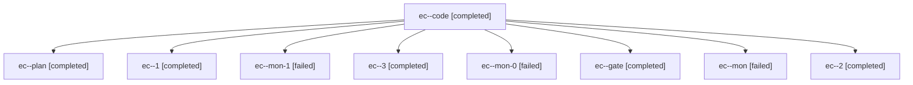

# Session: ec

[Agent Hoods](../README.md) / [bbugyi200](../users/bbugyi200/README.md) / [apollo](../users/bbugyi200/machines/apollo/README.md) / [ec](../users/bbugyi200/machines/apollo/hoods/ec/README.md) / ec

Owner: `bbugyi200.apollo` · Hood: `ec` · Members: 9

## Lineage

The diagram is an optional enhancement; the ordered table below contains the same lineage in accessible text.

| Role | Agent | State | Model / provider | Timing | Commits | Prompt | Chat |
|---|---|---|---|---|---:|---|---|
| code | ec--code | completed | gpt-6-luna / codex | 2026-11-16T11:51:51.682042+00:00 → 2026-11-16T12:30:30.463599+00:00 | 0 | [Prompt](../agents/bbugyi200.apollo.ec--code/prompt.md) | [Chat](../agents/bbugyi200.apollo.ec--code/chat.md) |
| plan | ec--plan | completed | opus / claude | 2026-11-16T11:09:25.417882+00:00 → 2026-11-16T11:40:52.740593+00:00 | 0 | [Prompt](../agents/bbugyi200.apollo.ec--plan/prompt.md) | [Chat](../agents/bbugyi200.apollo.ec--plan/chat.md) |
| 1 | ec--1 | completed | gpt-6-luna / codex | 2026-11-16T12:35:51.332293+00:00 → 2026-11-16T12:45:08.251820+00:00 | 0 | [Prompt](../agents/bbugyi200.apollo.ec--1/prompt.md) | [Chat](../agents/bbugyi200.apollo.ec--1/chat.md) |
| mon-1 | ec--mon-1 | failed | gpt-6-luna / codex | 2026-11-16T12:52:49.425412+00:00 → 2026-11-16T12:59:07.455019+00:00 | 0 | — | [Chat](../agents/bbugyi200.apollo.ec--mon-1/chat.md) |
| 3 | ec--3 | completed | gpt-6-luna / codex | 2026-11-16T12:59:36.285364+00:00 → 2026-11-16T13:07:19.109313+00:00 | 0 | [Prompt](../agents/bbugyi200.apollo.ec--3/prompt.md) | [Chat](../agents/bbugyi200.apollo.ec--3/chat.md) |
| mon-0 | ec--mon-0 | failed | gpt-6-luna / codex | 2026-11-16T12:43:54.862619+00:00 → 2026-11-16T12:47:19.311380+00:00 | 0 | — | [Chat](../agents/bbugyi200.apollo.ec--mon-0/chat.md) |
| gate | ec--gate | completed | opus / claude | 2026-11-16T11:50:03.487580+00:00 → 2026-11-16T11:51:17.644168+00:00 | 0 | — | [Chat](../agents/bbugyi200.apollo.ec--gate/chat.md) |
| mon | ec--mon | failed | gpt-6-luna / codex | 2026-11-16T12:29:23.243360+00:00 → 2026-11-16T12:35:15.392829+00:00 | 0 | — | [Chat](../agents/bbugyi200.apollo.ec--mon/chat.md) |
| 2 | ec--2 | completed | gpt-6-luna / codex | 2026-11-16T12:47:57.692933+00:00 → 2026-11-16T12:54:04.728040+00:00 | 0 | [Prompt](../agents/bbugyi200.apollo.ec--2/prompt.md) | [Chat](../agents/bbugyi200.apollo.ec--2/chat.md) |
