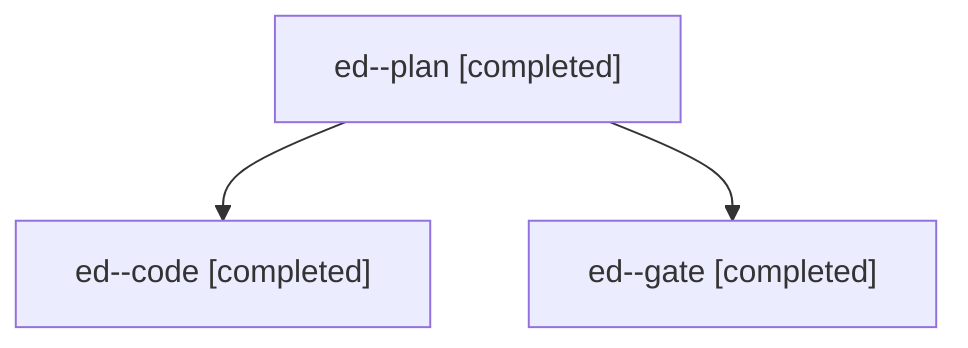

# Session: ed

[Agent Hoods](../README.md) / [bbugyi200](../users/bbugyi200/README.md) / [apollo](../users/bbugyi200/machines/apollo/README.md) / [ed](../users/bbugyi200/machines/apollo/hoods/ed/README.md) / ed

Owner: `bbugyi200.apollo` · Hood: `ed` · Members: 3

## Lineage

The diagram is an optional enhancement; the ordered table below contains the same lineage in accessible text.

| Role | Agent | State | Model / provider | Timing | Commits | Prompt | Chat |
|---|---|---|---|---|---:|---|---|
| plan | ed--plan | completed | opus / claude | 2026-11-16T11:40:15.120207+00:00 → 2026-11-16T11:54:47.903332+00:00 | 0 | [Prompt](../agents/bbugyi200.apollo.ed--plan/prompt.md) | [Chat](../agents/bbugyi200.apollo.ed--plan/chat.md) |
| code | ed--code | completed | grok-4.6 / grok | 2026-11-16T12:18:44.216197+00:00 → 2026-11-16T12:57:27.058242+00:00 | [1](../agents/bbugyi200.apollo.ed--code/README.md#commits) | [Prompt](../agents/bbugyi200.apollo.ed--code/prompt.md) | [Chat](../agents/bbugyi200.apollo.ed--code/chat.md) |
| gate | ed--gate | completed | opus / claude | 2026-11-16T12:17:06.235270+00:00 → 2026-11-16T12:18:08.103977+00:00 | 0 | — | [Chat](../agents/bbugyi200.apollo.ed--gate/chat.md) |

## Commits

| Role | Repo | Commit | Subject | Committed |
|---|---|---|---|---|
| code | bob-cli | [`d370233`](https://github.com/bobs-org/bob-cli/commit/d37023302c4c62ba23b40d397ee8a7cc6f44e041) | docs: land Ctrl+Enter from last PRE onto the next review group | 2026-11-16 07:56:40 EST |
