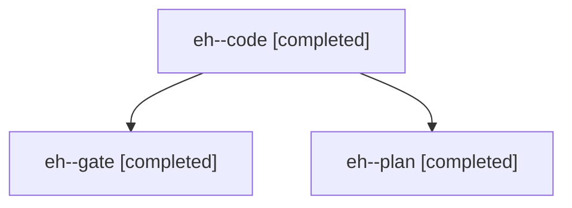

# Session: eh

[Agent Hoods](../README.md) / [bbugyi200](../users/bbugyi200/README.md) / [apollo](../users/bbugyi200/machines/apollo/README.md) / [eh](../users/bbugyi200/machines/apollo/hoods/eh/README.md) / eh

Owner: `bbugyi200.apollo` · Hood: `eh` · Members: 3

## Lineage

The diagram is an optional enhancement; the ordered table below contains the same lineage in accessible text.

| Role | Agent | State | Model / provider | Timing | Commits | Prompt | Chat |
|---|---|---|---|---|---:|---|---|
| code | eh--code | completed | muse-spark-1.3-contributor / muse | 2026-11-16T17:03:18.675736+00:00 → 2026-11-16T17:41:45.863406+00:00 | [1](../agents/bbugyi200.apollo.eh--code/README.md#commits) | [Prompt](../agents/bbugyi200.apollo.eh--code/prompt.md) | [Chat](../agents/bbugyi200.apollo.eh--code/chat.md) |
| gate | eh--gate | completed | opus / claude | 2026-11-16T17:01:54.420120+00:00 → 2026-11-16T17:02:48.140610+00:00 | 0 | — | [Chat](../agents/bbugyi200.apollo.eh--gate/chat.md) |
| plan | eh--plan | completed | opus / claude | 2026-11-16T16:45:21.004658+00:00 → 2026-11-16T17:00:40.526525+00:00 | 0 | [Prompt](../agents/bbugyi200.apollo.eh--plan/prompt.md) | [Chat](../agents/bbugyi200.apollo.eh--plan/chat.md) |

## Commits

| Role | Repo | Commit | Subject | Committed |
|---|---|---|---|---|
| code | bob-cli | [`50674ce`](https://github.com/bobs-org/bob-cli/commit/50674ce3d5b6182b3802aa0463f0b3272981e519) | docs(memory): name the new w attention dot in walker-footer glossary | 2026-11-16 12:41:05 EST |
