# Session: ei

[Agent Hoods](../README.md) / [bbugyi200](../users/bbugyi200/README.md) / [apollo](../users/bbugyi200/machines/apollo/README.md) / [ei](../users/bbugyi200/machines/apollo/hoods/ei/README.md) / ei

Owner: `bbugyi200.apollo` · Hood: `ei` · Members: 19

## Lineage

```mermaid
flowchart TD
  n0["ei--gate [completed]"]
  n1["ei--8 [completed]"]
  n0 --> n1
  n2["ei--mon-4 [completed]"]
  n0 --> n2
  n3["ei--5 [completed]"]
  n0 --> n3
  n4["ei--mon-3 [completed]"]
  n0 --> n4
  n5["ei--4 [completed]"]
  n0 --> n5
  n6["ei--mon-1 [completed]"]
  n0 --> n6
  n7["ei--mon [completed]"]
  n0 --> n7
  n8["ei--2 [completed]"]
  n0 --> n8
  n9["ei--1 [completed]"]
  n0 --> n9
  n10["ei--plan [completed]"]
  n0 --> n10
  n11["ei--7 [completed]"]
  n0 --> n11
  n12["ei--gate-1 [completed]"]
  n0 --> n12
  n13["ei--3 [completed]"]
  n0 --> n13
  n14["ei--code [completed]"]
  n0 --> n14
  n15["ei--mon-0 [completed]"]
  n0 --> n15
  n16["ei--6 [completed]"]
  n0 --> n16
  n17["ei--gate-0 [completed]"]
  n0 --> n17
  n18["ei--mon-2 [completed]"]
  n0 --> n18
```

The diagram is an optional enhancement; the ordered table below contains the same lineage in accessible text.

| Role | Agent | State | Model / provider | Timing | Commits | Prompt | Chat |
|---|---|---|---|---|---:|---|---|
| gate | ei--gate | completed | opus / claude | 2026-11-16T22:53:46.193217+00:00 → 2026-11-16T22:55:27.560856+00:00 | 0 | — | [Chat](../agents/bbugyi200.apollo.ei--gate/chat.md) |
| 8 | ei--8 | completed | gpt-6-luna / codex | 2026-11-17T10:13:33.896642+00:00 → 2026-11-17T10:19:04.477032+00:00 | [1](../agents/bbugyi200.apollo.ei--8/README.md#commits) | [Prompt](../agents/bbugyi200.apollo.ei--8/prompt.md) | [Chat](../agents/bbugyi200.apollo.ei--8/chat.md) |
| mon-4 | ei--mon-4 | completed | gpt-6-luna / codex | 2026-11-17T00:31:29.840037+00:00 → 2026-11-17T01:03:08.664248+00:00 | 0 | — | [Chat](../agents/bbugyi200.apollo.ei--mon-4/chat.md) |
| 5 | ei--5 | completed | gpt-6-luna / codex | 2026-11-17T00:30:26.744029+00:00 → 2026-11-17T00:32:14.221835+00:00 | 0 | [Prompt](../agents/bbugyi200.apollo.ei--5/prompt.md) | [Chat](../agents/bbugyi200.apollo.ei--5/chat.md) |
| mon-3 | ei--mon-3 | completed | gpt-6-luna / codex | 2026-11-17T00:27:58.505817+00:00 → 2026-11-17T00:30:26.922799+00:00 | 0 | — | [Chat](../agents/bbugyi200.apollo.ei--mon-3/chat.md) |
| 4 | ei--4 | completed | gpt-6-luna / codex | 2026-11-17T00:20:01.701968+00:00 → 2026-11-17T00:29:13.332288+00:00 | 0 | [Prompt](../agents/bbugyi200.apollo.ei--4/prompt.md) | [Chat](../agents/bbugyi200.apollo.ei--4/chat.md) |
| mon-1 | ei--mon-1 | completed | gpt-6-luna / codex | 2026-11-17T00:09:45.745317+00:00 → 2026-11-17T00:14:16.292390+00:00 | 0 | — | [Chat](../agents/bbugyi200.apollo.ei--mon-1/chat.md) |
| mon | ei--mon | completed | gpt-6-luna / codex | 2026-11-16T23:36:54.678933+00:00 → 2026-11-16T23:40:13.005779+00:00 | 0 | — | [Chat](../agents/bbugyi200.apollo.ei--mon/chat.md) |
| 2 | ei--2 | completed | gpt-6-luna / codex | 2026-11-17T00:07:52.815058+00:00 → 2026-11-17T00:10:42.696394+00:00 | 0 | [Prompt](../agents/bbugyi200.apollo.ei--2/prompt.md) | [Chat](../agents/bbugyi200.apollo.ei--2/chat.md) |
| 1 | ei--1 | completed | gpt-6-luna / codex | 2026-11-16T23:40:24.775330+00:00 → 2026-11-16T23:43:26.982044+00:00 | 0 | [Prompt](../agents/bbugyi200.apollo.ei--1/prompt.md) | [Chat](../agents/bbugyi200.apollo.ei--1/chat.md) |
| plan | ei--plan | completed | opus / claude | 2026-11-16T22:28:29.610503+00:00 → 2026-11-16T22:35:30.605432+00:00 | 0 | [Prompt](../agents/bbugyi200.apollo.ei--plan/prompt.md) | [Chat](../agents/bbugyi200.apollo.ei--plan/chat.md) |
| 7 | ei--7 | completed | gpt-6-luna / codex | 2026-11-17T08:54:35.633356+00:00 → 2026-11-17T09:16:17.902929+00:00 | 0 | [Prompt](../agents/bbugyi200.apollo.ei--7/prompt.md) | [Chat](../agents/bbugyi200.apollo.ei--7/chat.md) |
| gate-1 | ei--gate-1 | completed | gpt-6-luna / codex | 2026-11-17T10:12:21.803159+00:00 → 2026-11-17T10:12:41.791035+00:00 | 0 | — | [Chat](../agents/bbugyi200.apollo.ei--gate-1/chat.md) |
| 3 | ei--3 | completed | gpt-6-luna / codex | 2026-11-17T00:15:10.375305+00:00 → 2026-11-17T00:18:29.363812+00:00 | 0 | [Prompt](../agents/bbugyi200.apollo.ei--3/prompt.md) | [Chat](../agents/bbugyi200.apollo.ei--3/chat.md) |
| code | ei--code | completed | gpt-6-luna / codex | 2026-11-16T22:56:54.008605+00:00 → 2026-11-16T23:38:52.429144+00:00 | 0 | [Prompt](../agents/bbugyi200.apollo.ei--code/prompt.md) | [Chat](../agents/bbugyi200.apollo.ei--code/chat.md) |
| mon-0 | ei--mon-0 | completed | gpt-6-luna / codex | 2026-11-16T23:42:36.135343+00:00 → 2026-11-17T00:05:07.261416+00:00 | 0 | — | [Chat](../agents/bbugyi200.apollo.ei--mon-0/chat.md) |
| 6 | ei--6 | completed | gpt-6-luna / codex | 2026-11-17T01:03:08.455273+00:00 → 2026-11-17T01:10:30.181118+00:00 | 0 | [Prompt](../agents/bbugyi200.apollo.ei--6/prompt.md) | [Chat](../agents/bbugyi200.apollo.ei--6/chat.md) |
| gate-0 | ei--gate-0 | completed | gpt-6-luna / codex | 2026-11-17T08:53:08.137266+00:00 → 2026-11-17T08:53:34.369668+00:00 | 0 | — | [Chat](../agents/bbugyi200.apollo.ei--gate-0/chat.md) |
| mon-2 | ei--mon-2 | completed | gpt-6-luna / codex | 2026-11-17T00:17:30.693243+00:00 → 2026-11-17T00:20:02.076576+00:00 | 0 | — | [Chat](../agents/bbugyi200.apollo.ei--mon-2/chat.md) |

## Commits

| Role | Repo | Commit | Subject | Committed |
|---|---|---|---|---|
| 8 | bob-cli | [`cb537a0`](https://github.com/bobs-org/bob-cli/commit/cb537a0431dc3826283c5d48074b1b368425130b) | docs(glossary): document selected walker attention hue | 2026-11-17 05:18:34 EST |
