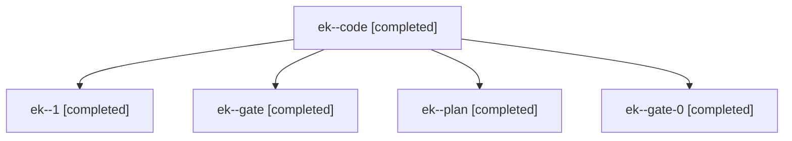

# Session: ek

[Agent Hoods](../README.md) / [bbugyi200](../users/bbugyi200/README.md) / [apollo](../users/bbugyi200/machines/apollo/README.md) / [ek](../users/bbugyi200/machines/apollo/hoods/ek/README.md) / ek

Owner: `bbugyi200.apollo` · Hood: `ek` · Members: 5

## Lineage

The diagram is an optional enhancement; the ordered table below contains the same lineage in accessible text.

| Role | Agent | State | Model / provider | Timing | Commits | Prompt | Chat |
|---|---|---|---|---|---:|---|---|
| code | ek--code | completed | grok-4.6 / grok | 2026-11-17T15:05:34.855720+00:00 → 2026-11-17T15:36:02.547877+00:00 | 0 | [Prompt](../agents/bbugyi200.apollo.ek--code/prompt.md) | [Chat](../agents/bbugyi200.apollo.ek--code/chat.md) |
| 1 | ek--1 | completed | grok-4.6 / grok | 2026-11-17T15:38:52.545779+00:00 → 2026-11-17T15:42:42.374938+00:00 | 0 | [Prompt](../agents/bbugyi200.apollo.ek--1/prompt.md) | [Chat](../agents/bbugyi200.apollo.ek--1/chat.md) |
| gate | ek--gate | completed | opus / claude | 2026-11-17T15:04:17.093677+00:00 → 2026-11-17T15:05:12.038534+00:00 | 0 | — | [Chat](../agents/bbugyi200.apollo.ek--gate/chat.md) |
| plan | ek--plan | completed | opus / claude | 2026-11-17T14:53:40.377797+00:00 → 2026-11-17T15:03:30.297175+00:00 | 0 | [Prompt](../agents/bbugyi200.apollo.ek--plan/prompt.md) | [Chat](../agents/bbugyi200.apollo.ek--plan/chat.md) |
| gate-0 | ek--gate-0 | completed | grok-4.6 / grok | 2026-11-17T15:37:29.747031+00:00 → 2026-11-17T15:38:12.054383+00:00 | 0 | — | [Chat](../agents/bbugyi200.apollo.ek--gate-0/chat.md) |
