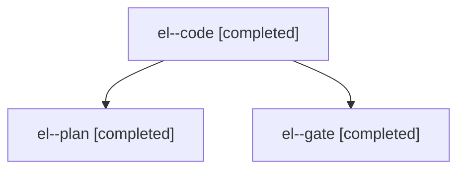

# Session: el

[Agent Hoods](../README.md) / [bbugyi200](../users/bbugyi200/README.md) / [apollo](../users/bbugyi200/machines/apollo/README.md) / [el](../users/bbugyi200/machines/apollo/hoods/el/README.md) / el

Owner: `bbugyi200.apollo` · Hood: `el` · Members: 3

## Lineage

The diagram is an optional enhancement; the ordered table below contains the same lineage in accessible text.

| Role | Agent | State | Model / provider | Timing | Commits | Prompt | Chat |
|---|---|---|---|---|---:|---|---|
| code | el--code | completed | muse-spark-1.3-contributor / muse | 2026-11-17T16:13:13.584359+00:00 → 2026-11-17T16:44:37.825349+00:00 | [1](../agents/bbugyi200.apollo.el--code/README.md#commits) | [Prompt](../agents/bbugyi200.apollo.el--code/prompt.md) | [Chat](../agents/bbugyi200.apollo.el--code/chat.md) |
| plan | el--plan | completed | opus / claude | 2026-11-17T15:58:15.956277+00:00 → 2026-11-17T16:10:41.572172+00:00 | 0 | [Prompt](../agents/bbugyi200.apollo.el--plan/prompt.md) | [Chat](../agents/bbugyi200.apollo.el--plan/chat.md) |
| gate | el--gate | completed | opus / claude | 2026-11-17T16:12:22.536637+00:00 → 2026-11-17T16:12:50.491354+00:00 | 0 | — | [Chat](../agents/bbugyi200.apollo.el--gate/chat.md) |

## Commits

| Role | Repo | Commit | Subject | Committed |
|---|---|---|---|---|
| code | bob-cli | [`11d7f89`](https://github.com/bobs-org/bob-cli/commit/11d7f89924e6c81ce5180b3cf170bcbde1a4114f) | docs(decisions): record q and ctrl-bracket mirror esc close keys | 2026-11-17 11:44:03 EST |
