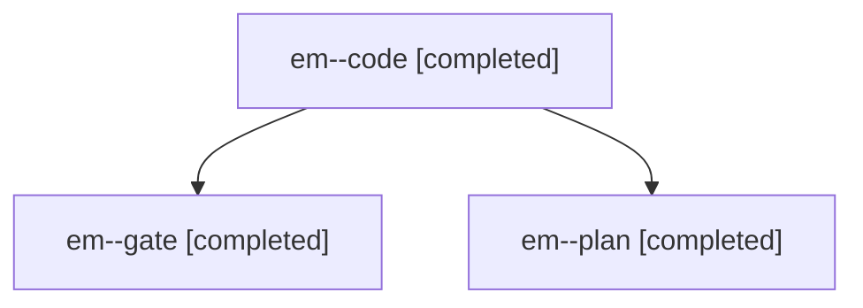

# Session: em

[Agent Hoods](../README.md) / [bbugyi200](../users/bbugyi200/README.md) / [apollo](../users/bbugyi200/machines/apollo/README.md) / [em](../users/bbugyi200/machines/apollo/hoods/em/README.md) / em

Owner: `bbugyi200.apollo` · Hood: `em` · Members: 3

## Lineage

The diagram is an optional enhancement; the ordered table below contains the same lineage in accessible text.

| Role | Agent | State | Model / provider | Timing | Commits | Prompt | Chat |
|---|---|---|---|---|---:|---|---|
| code | em--code | completed | muse-spark-1.3-contributor / muse | 2026-11-17T20:16:02.917715+00:00 → 2026-11-17T22:20:46.603677+00:00 | [1](../agents/bbugyi200.apollo.em--code/README.md#commits) | [Prompt](../agents/bbugyi200.apollo.em--code/prompt.md) | [Chat](../agents/bbugyi200.apollo.em--code/chat.md) |
| gate | em--gate | completed | opus / claude | 2026-11-17T20:14:00.715820+00:00 → 2026-11-17T20:15:26.573633+00:00 | 0 | — | [Chat](../agents/bbugyi200.apollo.em--gate/chat.md) |
| plan | em--plan | completed | opus / claude | 2026-11-17T20:02:27.719837+00:00 → 2026-11-17T20:13:04.879888+00:00 | 0 | [Prompt](../agents/bbugyi200.apollo.em--plan/prompt.md) | [Chat](../agents/bbugyi200.apollo.em--plan/chat.md) |

## Commits

| Role | Repo | Commit | Subject | Committed |
|---|---|---|---|---|
| code | bob-cli | [`cfc3177`](https://github.com/bobs-org/bob-cli/commit/cfc3177c4d7cf468be30eb71bd0ea8b36549ae40) | feat(records): create records without empty Notes section and add tidy command | 2026-11-17 17:20:10 EST |
