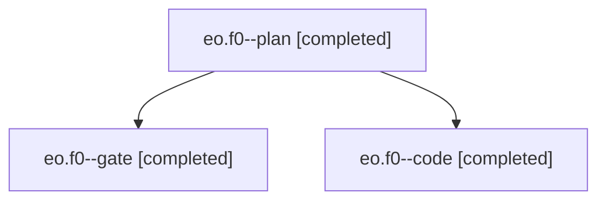

# Session: eo.f0

[Agent Hoods](../README.md) / [bbugyi200](../users/bbugyi200/README.md) / [apollo](../users/bbugyi200/machines/apollo/README.md) / [eo](../users/bbugyi200/machines/apollo/hoods/eo/README.md) / eo.f0

Owner: `bbugyi200.apollo` · Hood: `eo` · Members: 3

## Lineage

The diagram is an optional enhancement; the ordered table below contains the same lineage in accessible text.

| Role | Agent | State | Model / provider | Timing | Commits | Prompt | Chat |
|---|---|---|---|---|---:|---|---|
| plan | eo.f0--plan | completed | opus / claude | 2026-11-17T21:23:46.876274+00:00 → 2026-11-17T21:44:10.877021+00:00 | 0 | [Prompt](../agents/bbugyi200.apollo.eo.f0--plan/prompt.md) | [Chat](../agents/bbugyi200.apollo.eo.f0--plan/chat.md) |
| gate | eo.f0--gate | completed | opus / claude | 2026-11-17T21:48:36.900323+00:00 → 2026-11-17T21:49:35.389942+00:00 | 0 | — | [Chat](../agents/bbugyi200.apollo.eo.f0--gate/chat.md) |
| code | eo.f0--code | completed | muse-spark-1.3-contributor / muse | 2026-11-17T21:50:18.050867+00:00 → 2026-11-17T22:29:38.566560+00:00 | [1](../agents/bbugyi200.apollo.eo.f0--code/README.md#commits) | [Prompt](../agents/bbugyi200.apollo.eo.f0--code/prompt.md) | [Chat](../agents/bbugyi200.apollo.eo.f0--code/chat.md) |

## Commits

| Role | Repo | Commit | Subject | Committed |
|---|---|---|---|---|
| code | bob-cli | [`3914ab5`](https://github.com/bobs-org/bob-cli/commit/3914ab509c81df20545258bcf229898f8e83effa) | docs(reference): trim json-outputs.md back under its word budget | 2026-11-17 17:29:23 EST |

## Neighbors

| Agent | Relation | State |
|---|---|---|
| [eo](../agents/bbugyi200.apollo.eo/README.md) | ancestor | completed |
