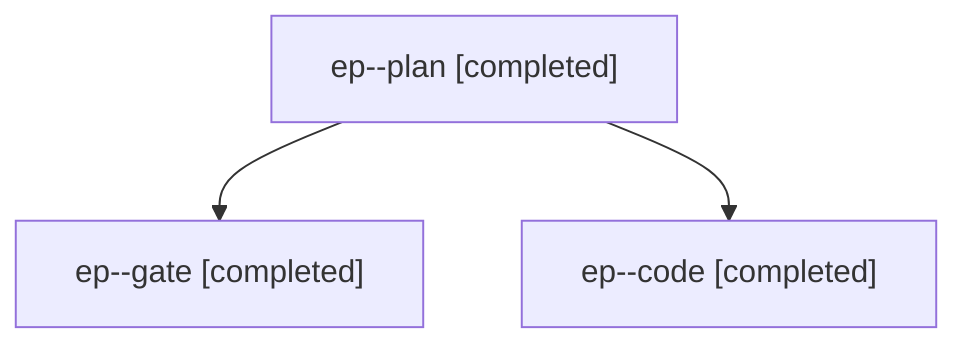

# Session: ep

[Agent Hoods](../README.md) / [bbugyi200](../users/bbugyi200/README.md) / [apollo](../users/bbugyi200/machines/apollo/README.md) / [ep](../users/bbugyi200/machines/apollo/hoods/ep/README.md) / ep

Owner: `bbugyi200.apollo` · Hood: `ep` · Members: 3

## Lineage

The diagram is an optional enhancement; the ordered table below contains the same lineage in accessible text.

| Role | Agent | State | Model / provider | Timing | Commits | Prompt | Chat |
|---|---|---|---|---|---:|---|---|
| plan | ep--plan | completed | opus / claude | 2026-11-17T22:09:25.110960+00:00 → 2026-11-17T22:19:07.616637+00:00 | 0 | [Prompt](../agents/bbugyi200.apollo.ep--plan/prompt.md) | [Chat](../agents/bbugyi200.apollo.ep--plan/chat.md) |
| gate | ep--gate | completed | opus / claude | 2026-11-17T22:22:20.527634+00:00 → 2026-11-17T22:24:54.524360+00:00 | 0 | — | [Chat](../agents/bbugyi200.apollo.ep--gate/chat.md) |
| code | ep--code | completed | muse-spark-1.3-contributor / muse | 2026-11-17T22:25:30.942366+00:00 → 2026-11-17T23:43:53.982130+00:00 | [1](../agents/bbugyi200.apollo.ep--code/README.md#commits) | [Prompt](../agents/bbugyi200.apollo.ep--code/prompt.md) | [Chat](../agents/bbugyi200.apollo.ep--code/chat.md) |

## Commits

| Role | Repo | Commit | Subject | Committed |
|---|---|---|---|---|
| code | bob-cli | [`9b8ab39`](https://github.com/bobs-org/bob-cli/commit/9b8ab39cfd4801ba822f9bdbe37893f1ba3a5c49) | feat(capture): expand item-start dot to route alias | 2026-11-17 18:43:04 EST |
