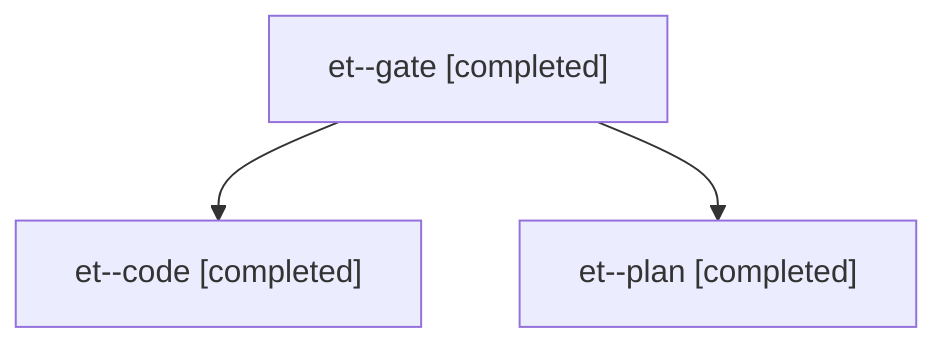

# Session: et

[Agent Hoods](../README.md) / [bbugyi200](../users/bbugyi200/README.md) / [apollo](../users/bbugyi200/machines/apollo/README.md) / [et](../users/bbugyi200/machines/apollo/hoods/et/README.md) / et

Owner: `bbugyi200.apollo` · Hood: `et` · Members: 3

## Lineage

The diagram is an optional enhancement; the ordered table below contains the same lineage in accessible text.

| Role | Agent | State | Model / provider | Timing | Commits | Prompt | Chat |
|---|---|---|---|---|---:|---|---|
| gate | et--gate | completed | opus / claude | 2026-11-17T23:09:57.698347+00:00 → 2026-11-17T23:11:35.354863+00:00 | 0 | — | [Chat](../agents/bbugyi200.apollo.et--gate/chat.md) |
| code | et--code | completed | muse-spark-1.3-contributor / muse | 2026-11-17T23:29:19.286865+00:00 → 2026-11-17T23:47:38.633046+00:00 | [1](../agents/bbugyi200.apollo.et--code/README.md#commits) | [Prompt](../agents/bbugyi200.apollo.et--code/prompt.md) | [Chat](../agents/bbugyi200.apollo.et--code/chat.md) |
| plan | et--plan | completed | opus / claude | 2026-11-17T22:52:35.280999+00:00 → 2026-11-17T23:10:03.719425+00:00 | 0 | [Prompt](../agents/bbugyi200.apollo.et--plan/prompt.md) | [Chat](../agents/bbugyi200.apollo.et--plan/chat.md) |

## Commits

| Role | Repo | Commit | Subject | Committed |
|---|---|---|---|---|
| code | bob-cli | [`225a6fb`](https://github.com/bobs-org/bob-cli/commit/225a6fb0228b35794e8a6b0b2d3c01b8ca5a6ba8) | docs(glossary): add Capture Panel and Ref Panel terms | 2026-11-17 18:47:13 EST |
