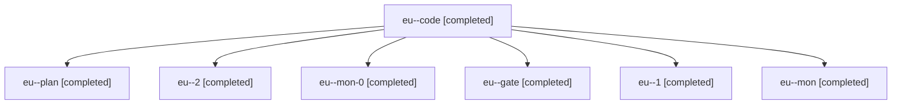

# Session: eu

[Agent Hoods](../README.md) / [bbugyi200](../users/bbugyi200/README.md) / [apollo](../users/bbugyi200/machines/apollo/README.md) / [eu](../users/bbugyi200/machines/apollo/hoods/eu/README.md) / eu

Owner: `bbugyi200.apollo` · Hood: `eu` · Members: 7

## Lineage

The diagram is an optional enhancement; the ordered table below contains the same lineage in accessible text.

| Role | Agent | State | Model / provider | Timing | Commits | Prompt | Chat |
|---|---|---|---|---|---:|---|---|
| code | eu--code | completed | gpt-6-luna / codex | 2026-11-18T01:51:47.962090+00:00 → 2026-11-18T02:11:03.984906+00:00 | 0 | [Prompt](../agents/bbugyi200.apollo.eu--code/prompt.md) | [Chat](../agents/bbugyi200.apollo.eu--code/chat.md) |
| plan | eu--plan | completed | opus / claude | 2026-11-17T23:43:55.062847+00:00 → 2026-11-17T23:54:03.587763+00:00 | 0 | [Prompt](../agents/bbugyi200.apollo.eu--plan/prompt.md) | [Chat](../agents/bbugyi200.apollo.eu--plan/chat.md) |
| 2 | eu--2 | completed | gpt-6-luna / codex | 2026-11-18T02:57:53.536083+00:00 → 2026-11-18T03:02:10.883257+00:00 | 0 | [Prompt](../agents/bbugyi200.apollo.eu--2/prompt.md) | [Chat](../agents/bbugyi200.apollo.eu--2/chat.md) |
| mon-0 | eu--mon-0 | completed | gpt-6-luna / codex | 2026-11-18T02:18:31.408839+00:00 → 2026-11-18T02:57:53.977723+00:00 | 0 | — | [Chat](../agents/bbugyi200.apollo.eu--mon-0/chat.md) |
| gate | eu--gate | completed | opus / claude | 2026-11-18T01:50:36.728371+00:00 → 2026-11-18T01:51:25.134670+00:00 | 0 | — | [Chat](../agents/bbugyi200.apollo.eu--gate/chat.md) |
| 1 | eu--1 | completed | gpt-6-luna / codex | 2026-11-18T02:17:29.738778+00:00 → 2026-11-18T02:19:06.752831+00:00 | 0 | [Prompt](../agents/bbugyi200.apollo.eu--1/prompt.md) | [Chat](../agents/bbugyi200.apollo.eu--1/chat.md) |
| mon | eu--mon | completed | gpt-6-luna / codex | 2026-11-18T02:09:50.948633+00:00 → 2026-11-18T02:17:29.855442+00:00 | 0 | — | [Chat](../agents/bbugyi200.apollo.eu--mon/chat.md) |
