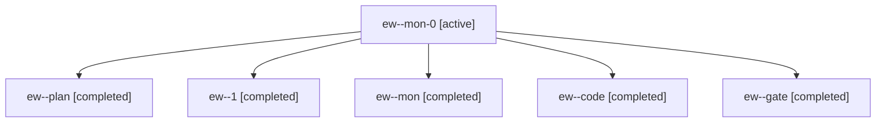

# Session: ew

[Agent Hoods](../README.md) / [bbugyi200](../users/bbugyi200/README.md) / [apollo](../users/bbugyi200/machines/apollo/README.md) / [ew](../users/bbugyi200/machines/apollo/hoods/ew/README.md) / ew

Owner: `bbugyi200.apollo` · Hood: `ew` · Members: 6

## Lineage

The diagram is an optional enhancement; the ordered table below contains the same lineage in accessible text.

| Role | Agent | State | Model / provider | Timing | Commits | Prompt | Chat |
|---|---|---|---|---|---:|---|---|
| mon-0 | ew--mon-0 | active | muse-spark-1.3-contributor / muse | 2026-11-18T15:20:01.186980+00:00 | 0 | — | — |
| plan | ew--plan | completed | opus / claude | 2026-11-18T14:07:59.922045+00:00 → 2026-11-18T14:16:56.680807+00:00 | 0 | [Prompt](../agents/bbugyi200.apollo.ew--plan/prompt.md) | [Chat](../agents/bbugyi200.apollo.ew--plan/chat.md) |
| 1 | ew--1 | completed | muse-spark-1.3-contributor / muse | 2026-11-18T15:16:21.115471+00:00 → 2026-11-18T15:22:19.950648+00:00 | 0 | [Prompt](../agents/bbugyi200.apollo.ew--1/prompt.md) | [Chat](../agents/bbugyi200.apollo.ew--1/chat.md) |
| mon | ew--mon | completed | muse-spark-1.3-contributor / muse | 2026-11-18T14:43:05.501506+00:00 → 2026-11-18T15:16:21.540645+00:00 | 0 | — | [Chat](../agents/bbugyi200.apollo.ew--mon/chat.md) |
| code | ew--code | completed | muse-spark-1.3-contributor / muse | 2026-11-18T14:18:23.396940+00:00 → 2026-11-18T14:44:56.553063+00:00 | 0 | [Prompt](../agents/bbugyi200.apollo.ew--code/prompt.md) | [Chat](../agents/bbugyi200.apollo.ew--code/chat.md) |
| gate | ew--gate | completed | opus / claude | 2026-11-18T14:17:17.063685+00:00 → 2026-11-18T14:17:59.099551+00:00 | 0 | — | [Chat](../agents/bbugyi200.apollo.ew--gate/chat.md) |
