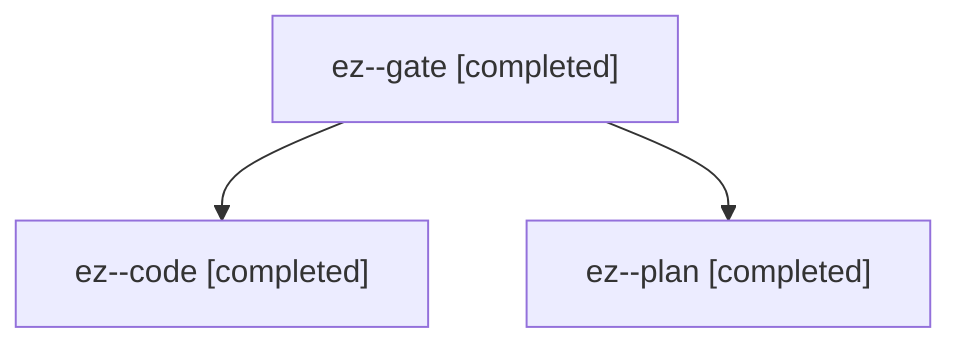

# Session: ez

[Agent Hoods](../README.md) / [bbugyi200](../users/bbugyi200/README.md) / [apollo](../users/bbugyi200/machines/apollo/README.md) / [ez](../users/bbugyi200/machines/apollo/hoods/ez/README.md) / ez

Owner: `bbugyi200.apollo` · Hood: `ez` · Members: 3

## Lineage

The diagram is an optional enhancement; the ordered table below contains the same lineage in accessible text.

| Role | Agent | State | Model / provider | Timing | Commits | Prompt | Chat |
|---|---|---|---|---|---:|---|---|
| gate | ez--gate | completed | opus / claude | 2026-11-18T17:22:16.142002+00:00 → 2026-11-18T17:24:14.032551+00:00 | 0 | — | [Chat](../agents/bbugyi200.apollo.ez--gate/chat.md) |
| code | ez--code | completed | muse-spark-1.3-contributor / muse | 2026-11-18T17:29:12.134381+00:00 → 2026-11-18T17:45:05.347716+00:00 | 0 | [Prompt](../agents/bbugyi200.apollo.ez--code/prompt.md) | [Chat](../agents/bbugyi200.apollo.ez--code/chat.md) |
| plan | ez--plan | completed | opus / claude | 2026-11-18T17:12:47.759437+00:00 → 2026-11-18T17:22:22.016784+00:00 | 0 | [Prompt](../agents/bbugyi200.apollo.ez--plan/prompt.md) | [Chat](../agents/bbugyi200.apollo.ez--plan/chat.md) |
