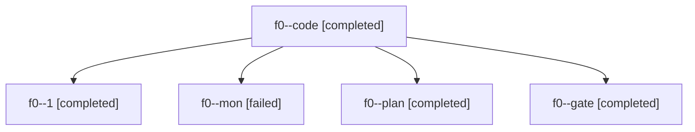

# Session: f0

[Agent Hoods](../README.md) / [bbugyi200](../users/bbugyi200/README.md) / [apollo](../users/bbugyi200/machines/apollo/README.md) / [f0](../users/bbugyi200/machines/apollo/hoods/f0/README.md) / f0

Owner: `bbugyi200.apollo` · Hood: `f0` · Members: 5

## Lineage

The diagram is an optional enhancement; the ordered table below contains the same lineage in accessible text.

| Role | Agent | State | Model / provider | Timing | Commits | Prompt | Chat |
|---|---|---|---|---|---:|---|---|
| code | f0--code | completed | muse-spark-1.3-contributor / muse | 2026-11-18T18:11:56.527826+00:00 → 2026-11-18T18:42:17.330093+00:00 | 0 | [Prompt](../agents/bbugyi200.apollo.f0--code/prompt.md) | [Chat](../agents/bbugyi200.apollo.f0--code/chat.md) |
| 1 | f0--1 | completed | muse-spark-1.3-contributor / muse | 2026-11-18T18:58:49.713375+00:00 → 2026-11-18T19:00:51.930824+00:00 | 0 | [Prompt](../agents/bbugyi200.apollo.f0--1/prompt.md) | [Chat](../agents/bbugyi200.apollo.f0--1/chat.md) |
| mon | f0--mon | failed | muse-spark-1.3-contributor / muse | 2026-11-18T18:41:12.151113+00:00 → 2026-11-18T18:58:50.050257+00:00 | 0 | — | [Chat](../agents/bbugyi200.apollo.f0--mon/chat.md) |
| plan | f0--plan | completed | opus / claude | 2026-11-18T18:03:57.103399+00:00 → 2026-11-18T18:09:58.774859+00:00 | 0 | [Prompt](../agents/bbugyi200.apollo.f0--plan/prompt.md) | [Chat](../agents/bbugyi200.apollo.f0--plan/chat.md) |
| gate | f0--gate | completed | opus / claude | 2026-11-18T18:10:35.577783+00:00 → 2026-11-18T18:11:32.218743+00:00 | 0 | — | [Chat](../agents/bbugyi200.apollo.f0--gate/chat.md) |
