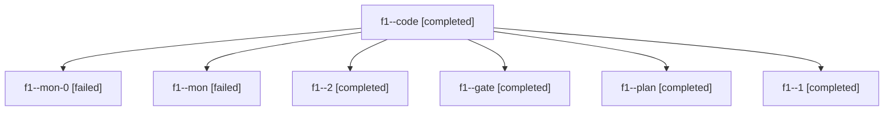

# Session: f1

[Agent Hoods](../README.md) / [bbugyi200](../users/bbugyi200/README.md) / [apollo](../users/bbugyi200/machines/apollo/README.md) / [f1](../users/bbugyi200/machines/apollo/hoods/f1/README.md) / f1

Owner: `bbugyi200.apollo` · Hood: `f1` · Members: 7

## Lineage

The diagram is an optional enhancement; the ordered table below contains the same lineage in accessible text.

| Role | Agent | State | Model / provider | Timing | Commits | Prompt | Chat |
|---|---|---|---|---|---:|---|---|
| code | f1--code | completed | gpt-6-luna / codex | 2026-11-18T18:32:11.028955+00:00 → 2026-11-18T19:33:07.692996+00:00 | 0 | [Prompt](../agents/bbugyi200.apollo.f1--code/prompt.md) | [Chat](../agents/bbugyi200.apollo.f1--code/chat.md) |
| mon-0 | f1--mon-0 | failed | gpt-6-luna / codex | 2026-11-18T19:55:50.885280+00:00 → 2026-11-18T20:13:25.039607+00:00 | 0 | — | [Chat](../agents/bbugyi200.apollo.f1--mon-0/chat.md) |
| mon | f1--mon | failed | gpt-6-luna / codex | 2026-11-18T19:31:30.160171+00:00 → 2026-11-18T19:53:05.425771+00:00 | 0 | — | [Chat](../agents/bbugyi200.apollo.f1--mon/chat.md) |
| 2 | f1--2 | completed | gpt-6-luna / codex | 2026-11-18T20:13:25.007442+00:00 → 2026-11-18T20:16:30.826273+00:00 | [1](../agents/bbugyi200.apollo.f1--2/README.md#commits) | [Prompt](../agents/bbugyi200.apollo.f1--2/prompt.md) | [Chat](../agents/bbugyi200.apollo.f1--2/chat.md) |
| gate | f1--gate | completed | opus / claude | 2026-11-18T18:27:27.772897+00:00 → 2026-11-18T18:30:12.484142+00:00 | 0 | — | [Chat](../agents/bbugyi200.apollo.f1--gate/chat.md) |
| plan | f1--plan | completed | opus / claude | 2026-11-18T18:18:05.620523+00:00 → 2026-11-18T18:26:22.255123+00:00 | 0 | [Prompt](../agents/bbugyi200.apollo.f1--plan/prompt.md) | [Chat](../agents/bbugyi200.apollo.f1--plan/chat.md) |
| 1 | f1--1 | completed | gpt-6-luna / codex | 2026-11-18T19:53:05.382603+00:00 → 2026-11-18T19:56:59.070430+00:00 | 0 | [Prompt](../agents/bbugyi200.apollo.f1--1/prompt.md) | [Chat](../agents/bbugyi200.apollo.f1--1/chat.md) |

## Commits

| Role | Repo | Commit | Subject | Committed |
|---|---|---|---|---|
| 2 | bob-cli | [`6cb387b`](https://github.com/bobs-org/bob-cli/commit/6cb387bc9dce27cebc515b2164ee2a8c83df201e) | feat(walks): report lane excess for attention marks | 2026-11-18 15:15:49 EST |
