# Session: f2

[Agent Hoods](../README.md) / [bbugyi200](../users/bbugyi200/README.md) / [apollo](../users/bbugyi200/machines/apollo/README.md) / [f2](../users/bbugyi200/machines/apollo/hoods/f2/README.md) / f2

Owner: `bbugyi200.apollo` · Hood: `f2` · Members: 21

## Lineage

```mermaid
flowchart TD
  n0["f2--8 [completed]"]
  n1["f2--1 [completed]"]
  n0 --> n1
  n2["f2--3 [completed]"]
  n0 --> n2
  n3["f2--plan [completed]"]
  n0 --> n3
  n4["f2--mon-1 [failed]"]
  n0 --> n4
  n5["f2--6 [completed]"]
  n0 --> n5
  n6["f2--mon-7 [completed]"]
  n0 --> n6
  n7["f2--mon-0 [failed]"]
  n0 --> n7
  n8["f2--mon-6 [failed]"]
  n0 --> n8
  n9["f2--5 [completed]"]
  n0 --> n9
  n10["f2--4 [completed]"]
  n0 --> n10
  n11["f2--7 [completed]"]
  n0 --> n11
  n12["f2--9 [completed]"]
  n0 --> n12
  n13["f2--mon-3 [failed]"]
  n0 --> n13
  n14["f2--mon-2 [failed]"]
  n0 --> n14
  n15["f2--2 [completed]"]
  n0 --> n15
  n16["f2--gate [completed]"]
  n0 --> n16
  n17["f2--mon-4 [failed]"]
  n0 --> n17
  n18["f2--mon-5 [failed]"]
  n0 --> n18
  n19["f2--code [completed]"]
  n0 --> n19
  n20["f2--mon [failed]"]
  n0 --> n20
```



The diagram is an optional enhancement; the ordered table below contains the same lineage in accessible text.

| Role | Agent | State | Model / provider | Timing | Commits | Prompt | Chat |
|---|---|---|---|---|---:|---|---|
| <a id="member-8"></a>8 | f2--8 | completed | gpt-6-luna / codex | 2026-11-19T17:20:58.677789+00:00 → 2026-11-19T17:39:37.929967+00:00 | 0 | [Prompt](../agents/bbugyi200.apollo.f2--8/prompt.md) | [Chat](../agents/bbugyi200.apollo.f2--8/chat.md) |
| <a id="member-1"></a>1 | f2--1 | completed | gpt-6-luna / codex | 2026-11-19T14:36:09.536028+00:00 → 2026-11-19T14:46:03.137671+00:00 | 0 | [Prompt](../agents/bbugyi200.apollo.f2--1/prompt.md) | [Chat](../agents/bbugyi200.apollo.f2--1/chat.md) |
| <a id="member-3"></a>3 | f2--3 | completed | gpt-6-luna / codex | 2026-11-19T15:21:11.676069+00:00 → 2026-11-19T15:34:06.364900+00:00 | 0 | [Prompt](../agents/bbugyi200.apollo.f2--3/prompt.md) | [Chat](../agents/bbugyi200.apollo.f2--3/chat.md) |
| <a id="member-plan"></a>plan | f2--plan | completed | opus / claude | 2026-11-19T13:15:32.087029+00:00 → 2026-11-19T13:27:23.799583+00:00 | 0 | [Prompt](../agents/bbugyi200.apollo.f2--plan/prompt.md) | [Chat](../agents/bbugyi200.apollo.f2--plan/chat.md) |
| <a id="member-mon-1"></a>mon-1 | f2--mon-1 | failed | gpt-6-luna / codex | 2026-11-19T15:18:23.402049+00:00 → 2026-11-19T15:21:11.909808+00:00 | 0 | — | [Chat](../agents/bbugyi200.apollo.f2--mon-1/chat.md) |
| <a id="member-6"></a>6 | f2--6 | completed | gpt-6-luna / codex | 2026-11-19T16:24:15.737683+00:00 → 2026-11-19T16:32:02.885421+00:00 | 0 | [Prompt](../agents/bbugyi200.apollo.f2--6/prompt.md) | [Chat](../agents/bbugyi200.apollo.f2--6/chat.md) |
| <a id="member-mon-7"></a>mon-7 | f2--mon-7 | completed | gpt-6-luna / codex | 2026-11-19T17:38:18.992787+00:00 → 2026-11-19T17:41:32.494772+00:00 | 0 | — | [Chat](../agents/bbugyi200.apollo.f2--mon-7/chat.md) |
| <a id="member-mon-0"></a>mon-0 | f2--mon-0 | failed | gpt-6-luna / codex | 2026-11-19T14:44:56.514424+00:00 → 2026-11-19T15:07:57.924437+00:00 | 0 | — | [Chat](../agents/bbugyi200.apollo.f2--mon-0/chat.md) |
| <a id="member-mon-6"></a>mon-6 | f2--mon-6 | failed | gpt-6-luna / codex | 2026-11-19T16:59:16.004504+00:00 → 2026-11-19T17:20:58.940341+00:00 | 0 | — | [Chat](../agents/bbugyi200.apollo.f2--mon-6/chat.md) |
| <a id="member-5"></a>5 | f2--5 | completed | gpt-6-luna / codex | 2026-11-19T16:07:02.130719+00:00 → 2026-11-19T16:22:37.623174+00:00 | 0 | [Prompt](../agents/bbugyi200.apollo.f2--5/prompt.md) | [Chat](../agents/bbugyi200.apollo.f2--5/chat.md) |
| <a id="member-4"></a>4 | f2--4 | completed | gpt-6-luna / codex | 2026-11-19T15:45:42.779359+00:00 → 2026-11-19T15:53:29.856622+00:00 | 0 | [Prompt](../agents/bbugyi200.apollo.f2--4/prompt.md) | [Chat](../agents/bbugyi200.apollo.f2--4/chat.md) |
| <a id="member-7"></a>7 | f2--7 | completed | gpt-6-luna / codex | 2026-11-19T16:46:49.627974+00:00 → 2026-11-19T17:00:26.596123+00:00 | 0 | [Prompt](../agents/bbugyi200.apollo.f2--7/prompt.md) | [Chat](../agents/bbugyi200.apollo.f2--7/chat.md) |
| <a id="member-9"></a>9 | f2--9 | completed | gpt-6-luna / codex | 2026-11-19T17:41:32.261575+00:00 → 2026-11-19T17:59:59.681412+00:00 | 0 | [Prompt](../agents/bbugyi200.apollo.f2--9/prompt.md) | [Chat](../agents/bbugyi200.apollo.f2--9/chat.md) |
| <a id="member-mon-3"></a>mon-3 | f2--mon-3 | failed | gpt-6-luna / codex | 2026-11-19T15:52:31.957362+00:00 → 2026-11-19T16:07:02.468065+00:00 | 0 | — | [Chat](../agents/bbugyi200.apollo.f2--mon-3/chat.md) |
| <a id="member-mon-2"></a>mon-2 | f2--mon-2 | failed | gpt-6-luna / codex | 2026-11-19T15:33:01.913223+00:00 → 2026-11-19T15:45:42.992893+00:00 | 0 | — | [Chat](../agents/bbugyi200.apollo.f2--mon-2/chat.md) |
| <a id="member-2"></a>2 | f2--2 | completed | gpt-6-luna / codex | 2026-11-19T15:07:58.836267+00:00 → 2026-11-19T15:19:40.249037+00:00 | 0 | [Prompt](../agents/bbugyi200.apollo.f2--2/prompt.md) | [Chat](../agents/bbugyi200.apollo.f2--2/chat.md) |
| <a id="member-gate"></a>gate | f2--gate | completed | opus / claude | 2026-11-19T13:58:17.584540+00:00 → 2026-11-19T14:00:36.442469+00:00 | 0 | — | [Chat](../agents/bbugyi200.apollo.f2--gate/chat.md) |
| <a id="member-mon-4"></a>mon-4 | f2--mon-4 | failed | gpt-6-luna / codex | 2026-11-19T16:21:29.173832+00:00 → 2026-11-19T16:24:16.125832+00:00 | 0 | — | [Chat](../agents/bbugyi200.apollo.f2--mon-4/chat.md) |
| <a id="member-mon-5"></a>mon-5 | f2--mon-5 | failed | gpt-6-luna / codex | 2026-11-19T16:31:12.968948+00:00 → 2026-11-19T16:46:44.558472+00:00 | 0 | — | [Chat](../agents/bbugyi200.apollo.f2--mon-5/chat.md) |
| <a id="member-code"></a>code | f2--code | completed | gpt-6-luna / codex | 2026-11-19T14:01:02.851048+00:00 → 2026-11-19T14:29:23.606671+00:00 | 0 | [Prompt](../agents/bbugyi200.apollo.f2--code/prompt.md) | [Chat](../agents/bbugyi200.apollo.f2--code/chat.md) |
| <a id="member-mon"></a>mon | f2--mon | failed | gpt-6-luna / codex | 2026-11-19T14:28:13.265948+00:00 → 2026-11-19T14:36:09.620829+00:00 | 0 | — | [Chat](../agents/bbugyi200.apollo.f2--mon/chat.md) |

## Variables

| Role | Variable | Value |
|---|---|---|
| 9 | `artifacts` | \[{bead: bob-cli-ms.8.3.1, kind: file, label: Record Card proof final acceptance, path: /home/bryan/.sase/artifacts/agents/gh\_bobs-org\_\_bob-cli/20261119124036/final-acceptance-0f1308671ef7.json, ref:… |

#### artifacts

**Role:** `9`

```yaml
- bead: bob-cli-ms.8.3.1
  kind: file
  label: Record Card proof final acceptance
  path: /home/bryan/.sase/artifacts/agents/gh_bobs-org__bob-cli/20261119124036/final-acceptance-0f1308671ef7.json
  ref: file:explicit:5e888ce1f58ed499423ae4b3
  source_path: /home/bryan/.local/state/sase/workspaces/bobs-org/bob-cli/bob-cli_10/.build/record-card-closeout-20261119/run-20261119T170026Z/final-acceptance.json
- bead: bob-cli-ms.8.3.1
  kind: file
  label: Record Card proof full run evidence archive
  path: /home/bryan/.sase/artifacts/agents/gh_bobs-org__bob-cli/20261119124036/record-card-proof-run-20261119T170026Z.tar-2644dba9785e.gz
  ref: file:explicit:9c017dc03bd9f1af8d040b71
  source_path: /home/bryan/.local/state/sase/workspaces/bobs-org/bob-cli/bob-cli_10/.build/record-card-closeout-20261119/record-card-proof-run-20261119T170026Z.tar.gz
```

Values are truncated for display; see each member's agent meta.json for the full values.
