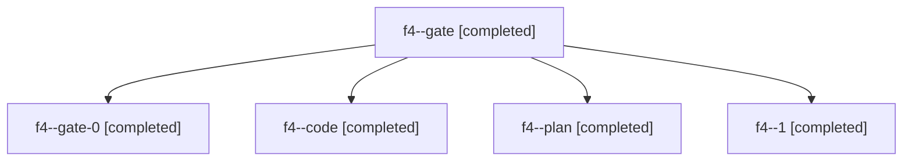

# Session: f4

[Agent Hoods](../README.md) / [bbugyi200](../users/bbugyi200/README.md) / [apollo](../users/bbugyi200/machines/apollo/README.md) / [f4](../users/bbugyi200/machines/apollo/hoods/f4/README.md) / f4

Owner: `bbugyi200.apollo` · Hood: `f4` · Members: 5

## Lineage

The diagram is an optional enhancement; the ordered table below contains the same lineage in accessible text.

| Role | Agent | State | Model / provider | Timing | Commits | Prompt | Chat |
|---|---|---|---|---|---:|---|---|
| gate | f4--gate | completed | opus / claude | 2026-11-19T21:26:51.688210+00:00 → 2026-11-19T21:27:40.817813+00:00 | 0 | — | [Chat](../agents/bbugyi200.apollo.f4--gate/chat.md) |
| gate-0 | f4--gate-0 | completed | gpt-6-luna / codex | 2026-11-19T22:25:43.345753+00:00 → 2026-11-19T22:26:07.480166+00:00 | 0 | — | [Chat](../agents/bbugyi200.apollo.f4--gate-0/chat.md) |
| code | f4--code | completed | gpt-6-luna / codex | 2026-11-19T21:28:07.844574+00:00 → 2026-11-19T22:22:43.004949+00:00 | 0 | [Prompt](../agents/bbugyi200.apollo.f4--code/prompt.md) | [Chat](../agents/bbugyi200.apollo.f4--code/chat.md) |
| plan | f4--plan | completed | opus / claude | 2026-11-19T21:14:19.699672+00:00 → 2026-11-19T21:26:05.540238+00:00 | 0 | [Prompt](../agents/bbugyi200.apollo.f4--plan/prompt.md) | [Chat](../agents/bbugyi200.apollo.f4--plan/chat.md) |
| 1 | f4--1 | completed | gpt-6-luna / codex | 2026-11-19T22:26:58.789351+00:00 → 2026-11-19T22:33:39.342914+00:00 | [1](../agents/bbugyi200.apollo.f4--1/README.md#commits) | [Prompt](../agents/bbugyi200.apollo.f4--1/prompt.md) | [Chat](../agents/bbugyi200.apollo.f4--1/chat.md) |

## Commits

| Role | Repo | Commit | Subject | Committed |
|---|---|---|---|---|
| 1 | bob-cli | [`2a5bc1f`](https://github.com/bobs-org/bob-cli/commit/2a5bc1f86a558ffbabf2a6798bc9ac36912e123b) | docs(memory): clarify task-scoped copy-chip lookup | 2026-11-19 17:33:00 EST |
