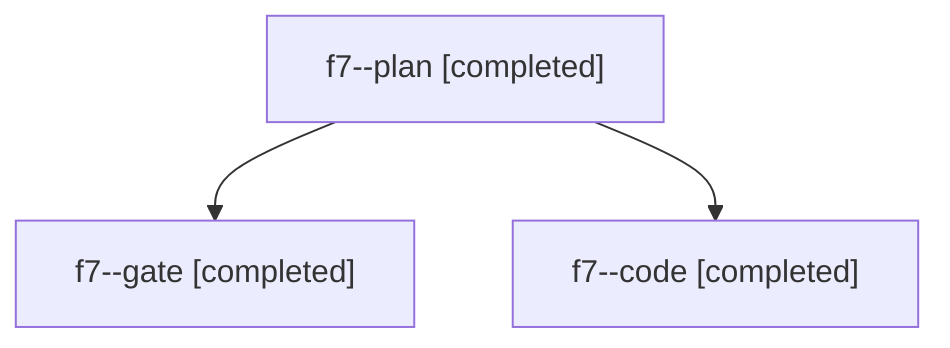

# Session: f7

[Agent Hoods](../README.md) / [bbugyi200](../users/bbugyi200/README.md) / [apollo](../users/bbugyi200/machines/apollo/README.md) / [f7](../users/bbugyi200/machines/apollo/hoods/f7/README.md) / f7

Owner: `bbugyi200.apollo` · Hood: `f7` · Members: 3

## Lineage

The diagram is an optional enhancement; the ordered table below contains the same lineage in accessible text.

| Role | Agent | State | Model / provider | Timing | Commits | Prompt | Chat |
|---|---|---|---|---|---:|---|---|
| plan | f7--plan | completed | opus / claude | 2026-11-20T16:23:07.147974+00:00 → 2026-11-20T16:39:18.262428+00:00 | 0 | [Prompt](../agents/bbugyi200.apollo.f7--plan/prompt.md) | [Chat](../agents/bbugyi200.apollo.f7--plan/chat.md) |
| gate | f7--gate | completed | opus / claude | 2026-11-20T16:40:08.076203+00:00 → 2026-11-20T16:41:14.010808+00:00 | 0 | — | [Chat](../agents/bbugyi200.apollo.f7--gate/chat.md) |
| code | f7--code | completed | opus / claude | 2026-11-20T16:41:41.663880+00:00 → 2026-11-20T17:27:10.961081+00:00 | [1](../agents/bbugyi200.apollo.f7--code/README.md#commits) | [Prompt](../agents/bbugyi200.apollo.f7--code/prompt.md) | [Chat](../agents/bbugyi200.apollo.f7--code/chat.md) |

## Commits

| Role | Repo | Commit | Subject | Committed |
|---|---|---|---|---|
| code | bob-cli | [`f9b0e2e`](https://github.com/bobs-org/bob-cli/commit/f9b0e2ed6d76007218b011f76b799eba9d8e0771) | fix(ref): follow the vault's Dataview inline-query prefix in note snapshots | 2026-11-20 12:26:38 EST |
