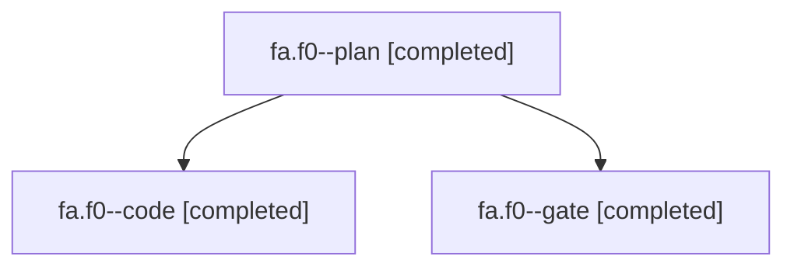

# Session: fa.f0

[Agent Hoods](../README.md) / [bbugyi200](../users/bbugyi200/README.md) / [apollo](../users/bbugyi200/machines/apollo/README.md) / [fa](../users/bbugyi200/machines/apollo/hoods/fa/README.md) / fa.f0

Owner: `bbugyi200.apollo` · Hood: `fa` · Members: 3

## Lineage



The diagram is an optional enhancement; the ordered table below contains the same lineage in accessible text.

| Role | Agent | State | Model / provider | Timing | Commits | Prompt | Chat |
|---|---|---|---|---|---:|---|---|
| <a id="member-plan"></a>plan | fa.f0--plan | completed | opus / claude | 2026-11-20T19:24:54.635245+00:00 → 2026-11-20T20:11:53.754294+00:00 | 0 | [Prompt](../agents/bbugyi200.apollo.fa.f0--plan/prompt.md) | [Chat](../agents/bbugyi200.apollo.fa.f0--plan/chat.md) |
| <a id="member-code"></a>code | fa.f0--code | completed | grok-4.6 / grok | 2026-11-20T20:37:18.074531+00:00 → 2026-11-20T21:26:21.098464+00:00 | [1](../agents/bbugyi200.apollo.fa.f0--code/README.md#commits) | [Prompt](../agents/bbugyi200.apollo.fa.f0--code/prompt.md) | [Chat](../agents/bbugyi200.apollo.fa.f0--code/chat.md) |
| <a id="member-gate"></a>gate | fa.f0--gate | completed | opus / claude | 2026-11-20T20:35:54.910322+00:00 → 2026-11-20T20:36:50.712029+00:00 | 0 | — | [Chat](../agents/bbugyi200.apollo.fa.f0--gate/chat.md) |

## Commits

| Role | Repo | Commit | Subject | Committed |
|---|---|---|---|---|
| code | bob-cli | [`a0c7d59`](https://github.com/bobs-org/bob-cli/commit/a0c7d59f8fa4f521607f5d9685d1409f7fca702a) | docs(glossary): describe command chips by their solid accent run well | 2026-11-20 16:22:14 EST |

## Variables

| Role | Variable | Value |
|---|---|---|
| plan | `artifacts` | \[{kind: image, label: Command chips redesign mockup (light): before vs solid run well, path: /home/bryan/.sase/artifacts/agents/gh\_bobs-org\_\_bob-cli/20261120133942/command-chips-redesign-light-6e98c0… |

#### artifacts

**Role:** `plan`

```yaml
- kind: image
  label: Command chips redesign mockup (light): before vs solid run well
  path: /home/bryan/.sase/artifacts/agents/gh_bobs-org__bob-cli/20261120133942/command-chips-redesign-light-6e98c0773202.png
  ref: file:explicit:4c41c148f7cef40c6f754702
  source_path: /home/bryan/.local/state/sase/workspaces/bobs-org/bob-cli/bob-cli_15/command-chips-redesign-light.png
- kind: image
  label: Command chips redesign mockup (dark): before vs solid run well
  path: /home/bryan/.sase/artifacts/agents/gh_bobs-org__bob-cli/20261120133942/command-chips-redesign-dark-d5356e822e1a.png
  ref: file:explicit:f6553589e913ef0a7323f494
  source_path: /home/bryan/.local/state/sase/workspaces/bobs-org/bob-cli/bob-cli_15/command-chips-redesign-dark.png
- kind: file
  label: Command chip run-well prototype CSS (both styles.css sections)
  path: /home/bryan/.sase/artifacts/agents/gh_bobs-org__bob-cli/20261120133942/command-chip-run-well-prototype-d6d98aa6f4df.css
  ref: file:explicit:39ee8943991facc192cec1c9
  source_path: /home/bryan/.local/state/sase/workspaces/bobs-org/bob-cli/bob-cli_15/command-chip-run-well-prototype.css
```

Values are truncated for display; see each member's agent meta.json for the full values.

## Neighbors

| Agent | Relation | State |
|---|---|---|
| [fa](bbugyi200.apollo.fa.md) (session · 3) | ancestor | completed 3 |
