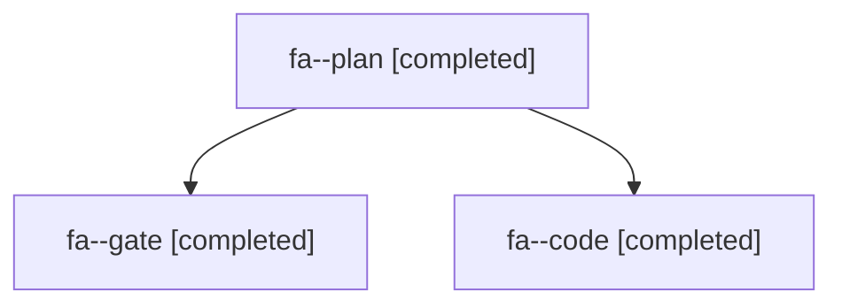

# Session: fa

[Agent Hoods](../README.md) / [bbugyi200](../users/bbugyi200/README.md) / [apollo](../users/bbugyi200/machines/apollo/README.md) / [fa](../users/bbugyi200/machines/apollo/hoods/fa/README.md) / fa

Owner: `bbugyi200.apollo` · Hood: `fa` · Members: 3

## Lineage



The diagram is an optional enhancement; the ordered table below contains the same lineage in accessible text.

| Role | Agent | State | Model / provider | Timing | Commits | Prompt | Chat |
|---|---|---|---|---|---:|---|---|
| <a id="member-plan"></a>plan | fa--plan | completed | opus / claude | 2026-11-20T17:35:52.391689+00:00 → 2026-11-20T17:58:51.444829+00:00 | 0 | [Prompt](../agents/bbugyi200.apollo.fa--plan/prompt.md) | [Chat](../agents/bbugyi200.apollo.fa--plan/chat.md) |
| <a id="member-gate"></a>gate | fa--gate | completed | opus / claude | 2026-11-20T17:59:05.601064+00:00 → 2026-11-20T18:00:03.363298+00:00 | 0 | — | [Chat](../agents/bbugyi200.apollo.fa--gate/chat.md) |
| <a id="member-code"></a>code | fa--code | completed | opus / claude | 2026-11-20T18:02:31.387297+00:00 → 2026-11-20T19:24:41.399285+00:00 | [1](../agents/bbugyi200.apollo.fa--code/README.md#commits) | [Prompt](../agents/bbugyi200.apollo.fa--code/prompt.md) | [Chat](../agents/bbugyi200.apollo.fa--code/chat.md) |

## Commits

| Role | Repo | Commit | Subject | Committed |
|---|---|---|---|---|
| code | bob-cli | [`620270d`](https://github.com/bobs-org/bob-cli/commit/620270d116a0d0c8fb0f546959dc230eff06d488) | docs(glossary): describe copy chips by their solid blue copy well | 2026-11-20 14:24:19 EST |

## Variables

| Role | Variable | Value |
|---|---|---|
| plan | `artifacts` | \[{kind: image, label: Copy chip redesign mockup (light), path: /home/bryan/.sase/artifacts/agents/gh\_bobs-org\_\_bob-cli/20261120123510/copy-chips-mockup-light-b7e130552a61.png, ref: file:explicit:cf07… |

#### artifacts

**Role:** `plan`

```yaml
- kind: image
  label: Copy chip redesign mockup (light)
  path: /home/bryan/.sase/artifacts/agents/gh_bobs-org__bob-cli/20261120123510/copy-chips-mockup-light-b7e130552a61.png
  ref: file:explicit:cf07ac247aed970f3efaa84f
  source_path: /tmp/copychip-artifacts/copy-chips-mockup-light.png
- kind: image
  label: Copy chip redesign mockup (dark)
  path: /home/bryan/.sase/artifacts/agents/gh_bobs-org__bob-cli/20261120123510/copy-chips-mockup-dark-29f21098e141.png
  ref: file:explicit:848b252dda32714e1c868bbf
  source_path: /tmp/copychip-artifacts/copy-chips-mockup-dark.png
```

Values are truncated for display; see each member's agent meta.json for the full values.

## Neighbors

| Agent | Relation | State |
|---|---|---|
| [fa.f0](../agents/bbugyi200.apollo.fa.f0/README.md) | descendant | waiting |
