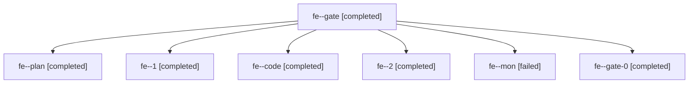

# Session: fe

[Agent Hoods](../README.md) / [bbugyi200](../users/bbugyi200/README.md) / [apollo](../users/bbugyi200/machines/apollo/README.md) / [fe](../users/bbugyi200/machines/apollo/hoods/fe/README.md) / fe

Owner: `bbugyi200.apollo` · Hood: `fe` · Members: 7

## Lineage

The diagram is an optional enhancement; the ordered table below contains the same lineage in accessible text.

| Role | Agent | State | Model / provider | Timing | Commits | Prompt | Chat |
|---|---|---|---|---|---:|---|---|
| gate | fe--gate | completed | opus / claude | 2026-11-21T12:38:09.068045+00:00 → 2026-11-21T12:38:48.926643+00:00 | 0 | — | [Chat](../agents/bbugyi200.apollo.fe--gate/chat.md) |
| plan | fe--plan | completed | opus / claude | 2026-11-21T12:30:07.458192+00:00 → 2026-11-21T12:37:40.210356+00:00 | 0 | [Prompt](../agents/bbugyi200.apollo.fe--plan/prompt.md) | [Chat](../agents/bbugyi200.apollo.fe--plan/chat.md) |
| 1 | fe--1 | completed | gpt-6-luna / codex | 2026-11-21T13:18:21.532039+00:00 → 2026-11-21T13:22:30.521629+00:00 | 0 | [Prompt](../agents/bbugyi200.apollo.fe--1/prompt.md) | [Chat](../agents/bbugyi200.apollo.fe--1/chat.md) |
| code | fe--code | completed | gpt-6-luna / codex | 2026-11-21T12:39:08.677636+00:00 → 2026-11-21T13:12:18.208182+00:00 | 0 | [Prompt](../agents/bbugyi200.apollo.fe--code/prompt.md) | [Chat](../agents/bbugyi200.apollo.fe--code/chat.md) |
| 2 | fe--2 | completed | gpt-6-luna / codex | 2026-11-21T13:39:38.179780+00:00 → 2026-11-21T13:47:05.628296+00:00 | 0 | [Prompt](../agents/bbugyi200.apollo.fe--2/prompt.md) | [Chat](../agents/bbugyi200.apollo.fe--2/chat.md) |
| mon | fe--mon | failed | gpt-6-luna / codex | 2026-11-21T13:11:04.521820+00:00 → 2026-11-21T13:18:00.048380+00:00 | 0 | — | [Chat](../agents/bbugyi200.apollo.fe--mon/chat.md) |
| gate-0 | fe--gate-0 | completed | gpt-6-luna / codex | 2026-11-21T13:38:43.709895+00:00 → 2026-11-21T13:39:01.648499+00:00 | 0 | — | [Chat](../agents/bbugyi200.apollo.fe--gate-0/chat.md) |
