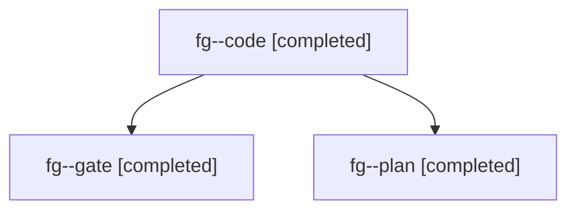

# Session: fg

[Agent Hoods](../README.md) / [bbugyi200](../users/bbugyi200/README.md) / [apollo](../users/bbugyi200/machines/apollo/README.md) / [fg](../users/bbugyi200/machines/apollo/hoods/fg/README.md) / fg

Owner: `bbugyi200.apollo` · Hood: `fg` · Members: 3

## Lineage

The diagram is an optional enhancement; the ordered table below contains the same lineage in accessible text.

| Role | Agent | State | Model / provider | Timing | Commits | Prompt | Chat |
|---|---|---|---|---|---:|---|---|
| code | fg--code | completed | sonnet / claude | 2026-11-21T20:16:09.106591+00:00 → 2026-11-21T20:26:48.328210+00:00 | 0 | [Prompt](../agents/bbugyi200.apollo.fg--code/prompt.md) | [Chat](../agents/bbugyi200.apollo.fg--code/chat.md) |
| gate | fg--gate | completed | opus / claude | 2026-11-21T20:15:15.019027+00:00 → 2026-11-21T20:15:45.214030+00:00 | 0 | — | [Chat](../agents/bbugyi200.apollo.fg--gate/chat.md) |
| plan | fg--plan | completed | opus / claude | 2026-11-21T20:08:21.481663+00:00 → 2026-11-21T20:14:48.754824+00:00 | 0 | [Prompt](../agents/bbugyi200.apollo.fg--plan/prompt.md) | [Chat](../agents/bbugyi200.apollo.fg--plan/chat.md) |
