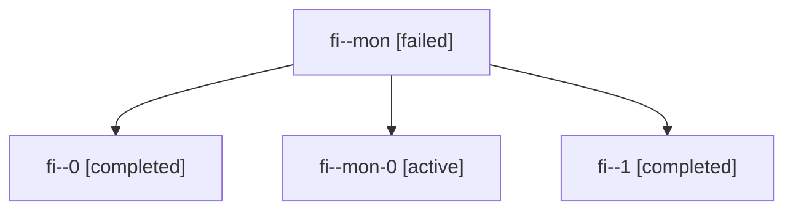

# Session: fi

[Agent Hoods](../README.md) / [bbugyi200](../users/bbugyi200/README.md) / [apollo](../users/bbugyi200/machines/apollo/README.md) / [fi](../users/bbugyi200/machines/apollo/hoods/fi/README.md) / fi

Owner: `bbugyi200.apollo` · Hood: `fi` · Members: 4

## Lineage

The diagram is an optional enhancement; the ordered table below contains the same lineage in accessible text.

| Role | Agent | State | Model / provider | Timing | Commits | Prompt | Chat |
|---|---|---|---|---|---:|---|---|
| mon | fi--mon | failed | gpt-6-astra / codex | 2026-11-22T14:51:15.298858+00:00 → 2026-11-22T14:59:01.094988+00:00 | 0 | — | [Chat](../agents/bbugyi200.apollo.fi--mon/chat.md) |
| 0 | fi--0 | completed | gpt-6-astra / codex | 2026-11-22T14:40:53.222626+00:00 → 2026-11-22T14:51:57.395449+00:00 | 0 | [Prompt](../agents/bbugyi200.apollo.fi--0/prompt.md) | [Chat](../agents/bbugyi200.apollo.fi--0/chat.md) |
| mon-0 | fi--mon-0 | active | gpt-6-astra / codex | 2026-11-22T15:22:41.875661+00:00 | 0 | — | — |
| 1 | fi--1 | completed | gpt-6-astra / codex | 2026-11-22T14:59:00.842483+00:00 → 2026-11-22T15:24:08.553930+00:00 | 0 | [Prompt](../agents/bbugyi200.apollo.fi--1/prompt.md) | [Chat](../agents/bbugyi200.apollo.fi--1/chat.md) |
