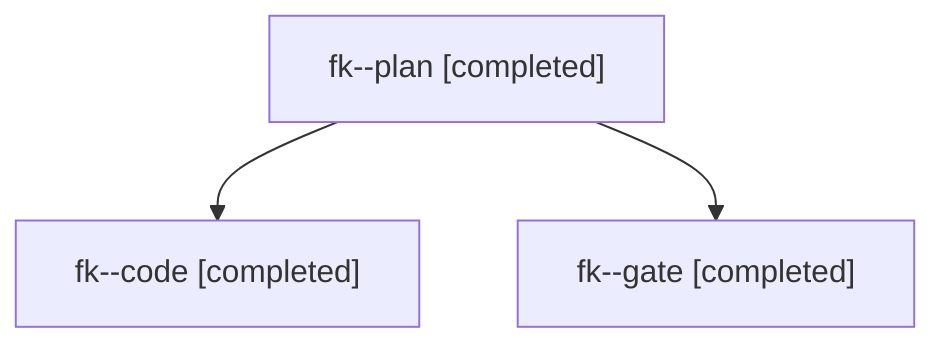

# Session: fk

[Agent Hoods](../README.md) / [bbugyi200](../users/bbugyi200/README.md) / [apollo](../users/bbugyi200/machines/apollo/README.md) / [fk](../users/bbugyi200/machines/apollo/hoods/fk/README.md) / fk

Owner: `bbugyi200.apollo` · Hood: `fk` · Members: 3

## Lineage

The diagram is an optional enhancement; the ordered table below contains the same lineage in accessible text.

| Role | Agent | State | Model / provider | Timing | Commits | Prompt | Chat |
|---|---|---|---|---|---:|---|---|
| plan | fk--plan | completed | opus / claude | 2026-11-22T15:11:18.050831+00:00 → 2026-11-22T15:21:15.016623+00:00 | 0 | [Prompt](../agents/bbugyi200.apollo.fk--plan/prompt.md) | [Chat](../agents/bbugyi200.apollo.fk--plan/chat.md) |
| code | fk--code | completed | sonnet / claude | 2026-11-22T15:25:17.311144+00:00 → 2026-11-22T16:21:37.346592+00:00 | [1](../agents/bbugyi200.apollo.fk--code/README.md#commits) | [Prompt](../agents/bbugyi200.apollo.fk--code/prompt.md) | [Chat](../agents/bbugyi200.apollo.fk--code/chat.md) |
| gate | fk--gate | completed | opus / claude | 2026-11-22T15:24:00.088819+00:00 → 2026-11-22T15:24:50.570032+00:00 | 0 | — | [Chat](../agents/bbugyi200.apollo.fk--gate/chat.md) |

## Commits

| Role | Repo | Commit | Subject | Committed |
|---|---|---|---|---|
| code | bob-cli | [`a21fd55`](https://github.com/bobs-org/bob-cli/commit/a21fd556f0037ff027bc8d99049c823c90d26fd2) | feat(albums): group the records index by index\_group\_by | 2026-11-22 11:21:14 EST |
