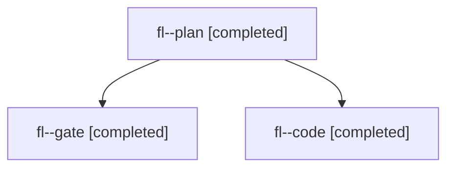

# Session: fl

[Agent Hoods](../README.md) / [bbugyi200](../users/bbugyi200/README.md) / [apollo](../users/bbugyi200/machines/apollo/README.md) / [fl](../users/bbugyi200/machines/apollo/hoods/fl/README.md) / fl

Owner: `bbugyi200.apollo` · Hood: `fl` · Members: 3

## Lineage

The diagram is an optional enhancement; the ordered table below contains the same lineage in accessible text.

| Role | Agent | State | Model / provider | Timing | Commits | Prompt | Chat |
|---|---|---|---|---|---:|---|---|
| plan | fl--plan | completed | opus / claude | 2026-11-22T15:58:35.804649+00:00 → 2026-11-22T16:05:07.721781+00:00 | 0 | [Prompt](../agents/bbugyi200.apollo.fl--plan/prompt.md) | [Chat](../agents/bbugyi200.apollo.fl--plan/chat.md) |
| gate | fl--gate | completed | opus / claude | 2026-11-22T16:09:40.187229+00:00 → 2026-11-22T16:10:57.764722+00:00 | 0 | — | [Chat](../agents/bbugyi200.apollo.fl--gate/chat.md) |
| code | fl--code | completed | muse-spark-1.3-contributor / muse | 2026-11-22T16:11:39.810163+00:00 → 2026-11-22T16:40:10.739994+00:00 | [1](../agents/bbugyi200.apollo.fl--code/README.md#commits) | [Prompt](../agents/bbugyi200.apollo.fl--code/prompt.md) | [Chat](../agents/bbugyi200.apollo.fl--code/chat.md) |

## Commits

| Role | Repo | Commit | Subject | Committed |
|---|---|---|---|---|
| code | bob-cli | [`b7945e7`](https://github.com/bobs-org/bob-cli/commit/b7945e75d038506675de04f06bac826990db3d27) | docs(task-dependencies): SO33 conflict copies never feed successor offers | 2026-11-22 11:39:12 EST |
