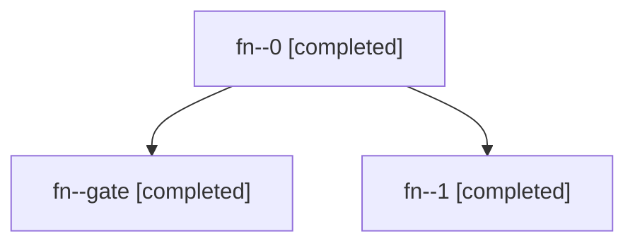

# Session: fn

[Agent Hoods](../README.md) / [bbugyi200](../users/bbugyi200/README.md) / [apollo](../users/bbugyi200/machines/apollo/README.md) / [fn](../users/bbugyi200/machines/apollo/hoods/fn/README.md) / fn

Owner: `bbugyi200.apollo` · Hood: `fn` · Members: 3

## Lineage



The diagram is an optional enhancement; the ordered table below contains the same lineage in accessible text.

| Role | Agent | State | Model / provider | Timing | Commits | Prompt | Chat |
|---|---|---|---|---|---:|---|---|
| <a id="member-0"></a>0 | fn--0 | completed | gpt-6-astra / codex | 2026-11-22T16:38:41.635791+00:00 → 2026-11-22T17:14:10.717973+00:00 | 0 | [Prompt](../agents/bbugyi200.apollo.fn--0/prompt.md) | [Chat](../agents/bbugyi200.apollo.fn--0/chat.md) |
| <a id="member-gate"></a>gate | fn--gate | completed | gpt-6-astra / codex | 2026-11-22T17:14:38.151430+00:00 → 2026-11-22T17:15:27.560878+00:00 | 0 | — | [Chat](../agents/bbugyi200.apollo.fn--gate/chat.md) |
| <a id="member-1"></a>1 | fn--1 | completed | gpt-6-astra / codex | 2026-11-22T17:17:31.946753+00:00 → 2026-11-22T17:24:42.896386+00:00 | 0 | [Prompt](../agents/bbugyi200.apollo.fn--1/prompt.md) | — |

## Variables

| Role | Variable | Value |
|---|---|---|
| 0 | `artifacts` | \[{kind: file, label: oz completion initial athena timing failures, path: /home/bryan/.sase/artifacts/agents/gh\_bobs-org\_\_bob-cli/20261122113805/oz-timing-evidence-86ad9845a90d.txt, ref: file:explicit… |

#### artifacts

**Role:** `0`

```yaml
- kind: file
  label: oz completion initial athena timing failures
  path: /home/bryan/.sase/artifacts/agents/gh_bobs-org__bob-cli/20261122113805/oz-timing-evidence-86ad9845a90d.txt
  ref: file:explicit:188a5892081fc88c43d02905
  source_path: /tmp/oz-timing-evidence.txt
- kind: file
  label: oz final source verification and remaining deployment blocker
  path: /home/bryan/.sase/artifacts/agents/gh_bobs-org__bob-cli/20261122113805/oz-completion-evidence-8702b1a4f8a3.json
  ref: file:explicit:9c6bae5989e283ddb6d9994b
  source_path: /tmp/oz-completion-evidence.json
- kind: file
  label: oz prepared close note pending navigation repair
  path: /home/bryan/.sase/artifacts/agents/gh_bobs-org__bob-cli/20261122113805/oz-close-note-6b48406e7032.txt
  ref: file:explicit:122acef75eaa97414f513f57
  source_path: /tmp/oz-close-note.txt
```

Values are truncated for display; see each member's agent meta.json for the full values.
