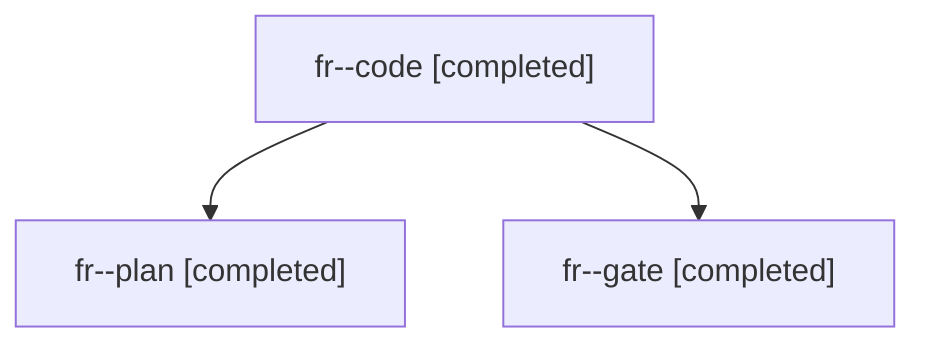

# Session: fr

[Agent Hoods](../README.md) / [bbugyi200](../users/bbugyi200/README.md) / [apollo](../users/bbugyi200/machines/apollo/README.md) / [fr](../users/bbugyi200/machines/apollo/hoods/fr/README.md) / fr

Owner: `bbugyi200.apollo` · Hood: `fr` · Members: 3

## Lineage

The diagram is an optional enhancement; the ordered table below contains the same lineage in accessible text.

| Role | Agent | State | Model / provider | Timing | Commits | Prompt | Chat |
|---|---|---|---|---|---:|---|---|
| code | fr--code | completed | muse-spark-1.3-contributor / muse | 2026-11-23T16:43:18.797731+00:00 → 2026-11-23T17:14:04.088815+00:00 | [1](../agents/bbugyi200.apollo.fr--code/README.md#commits) | [Prompt](../agents/bbugyi200.apollo.fr--code/prompt.md) | [Chat](../agents/bbugyi200.apollo.fr--code/chat.md) |
| plan | fr--plan | completed | opus / claude | 2026-11-23T16:28:54.506125+00:00 → 2026-11-23T16:41:33.558555+00:00 | 0 | [Prompt](../agents/bbugyi200.apollo.fr--plan/prompt.md) | [Chat](../agents/bbugyi200.apollo.fr--plan/chat.md) |
| gate | fr--gate | completed | opus / claude | 2026-11-23T16:42:23.222731+00:00 → 2026-11-23T16:42:53.031506+00:00 | 0 | — | [Chat](../agents/bbugyi200.apollo.fr--gate/chat.md) |

## Commits

| Role | Repo | Commit | Subject | Committed |
|---|---|---|---|---|
| code | bob-cli | [`19d5df9`](https://github.com/bobs-org/bob-cli/commit/19d5df9e50d4b0e102e770bd64b09fbe5f5124ed) | feat(relations): document links stage event tasks LG25-LG29 | 2026-11-23 12:13:29 EST |
