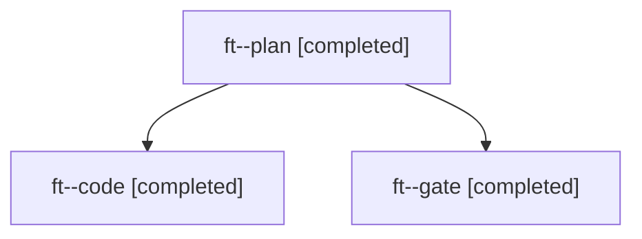

# Session: ft

[Agent Hoods](../README.md) / [bbugyi200](../users/bbugyi200/README.md) / [apollo](../users/bbugyi200/machines/apollo/README.md) / [ft](../users/bbugyi200/machines/apollo/hoods/ft/README.md) / ft

Owner: `bbugyi200.apollo` · Hood: `ft` · Members: 3

## Lineage



The diagram is an optional enhancement; the ordered table below contains the same lineage in accessible text.

| Role | Agent | State | Model / provider | Timing | Commits | Prompt | Chat |
|---|---|---|---|---|---:|---|---|
| <a id="member-plan"></a>plan | ft--plan | completed | opus / claude | 2026-11-24T11:47:21.929920+00:00 → 2026-11-24T11:57:57.847031+00:00 | 0 | [Prompt](../agents/bbugyi200.apollo.ft--plan/prompt.md) | [Chat](../agents/bbugyi200.apollo.ft--plan/chat.md) |
| <a id="member-code"></a>code | ft--code | completed | grok-4.6 / grok | 2026-11-24T12:00:53.287415+00:00 → 2026-11-24T12:41:37.600698+00:00 | 0 | [Prompt](../agents/bbugyi200.apollo.ft--code/prompt.md) | [Chat](../agents/bbugyi200.apollo.ft--code/chat.md) |
| <a id="member-gate"></a>gate | ft--gate | completed | opus / claude | 2026-11-24T11:59:51.111577+00:00 → 2026-11-24T12:00:22.980025+00:00 | 0 | — | [Chat](../agents/bbugyi200.apollo.ft--gate/chat.md) |

## Variables

| Role | Variable | Value |
|---|---|---|
| code | `artifacts` | \[{kind: file, label: card-foot e2e report (bare -/+), path: /home/bryan/.sase/artifacts/agents/gh\_bobs-org\_\_bob-cli/20261124070022/card-foot-e2e-7d939f895bed.json, ref: file:explicit:d12706add645522e… |

#### artifacts

**Role:** `code`

```yaml
- kind: file
  label: card-foot e2e report (bare -/+)
  path: /home/bryan/.sase/artifacts/agents/gh_bobs-org__bob-cli/20261124070022/card-foot-e2e-7d939f895bed.json
  ref: file:explicit:d12706add645522ec1aaaab9
  source_path: /tmp/bare-minus-plus-e2e/card-foot-e2e.json
- kind: file
  label: property-editor e2e report (bare -/+)
  path: /home/bryan/.sase/artifacts/agents/gh_bobs-org__bob-cli/20261124070022/property-editor-e2e-39b597b0bf92.json
  ref: file:explicit:ee61e7fc833562064fe940df
  source_path: /tmp/bare-minus-plus-e2e/property-editor-e2e.json
- kind: file
  label: athena e2e screenshots (bare -/+)
  path: /home/bryan/.sase/artifacts/agents/gh_bobs-org__bob-cli/20261124070022/bare-minus-plus-e2e-shots-948ca834cf52.tgz
  ref: file:explicit:2a30db799cd3de549e182b8e
  source_path: /tmp/bare-minus-plus-e2e/bare-minus-plus-e2e-shots.tgz
```

Values are truncated for display; see each member's agent meta.json for the full values.
