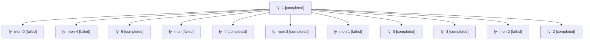

# Session: fy

[Agent Hoods](../README.md) / [bbugyi200](../users/bbugyi200/README.md) / [apollo](../users/bbugyi200/machines/apollo/README.md) / [fy](../users/bbugyi200/machines/apollo/hoods/fy/README.md) / fy

Owner: `bbugyi200.apollo` · Hood: `fy` · Members: 12

## Lineage

The diagram is an optional enhancement; the ordered table below contains the same lineage in accessible text.

| Role | Agent | State | Model / provider | Timing | Commits | Prompt | Chat |
|---|---|---|---|---|---:|---|---|
| 1 | fy--1 | completed | gpt-6-astra / codex | 2026-11-24T16:08:44.227920+00:00 → 2026-11-24T16:13:27.186618+00:00 | 0 | [Prompt](../agents/bbugyi200.apollo.fy--1/prompt.md) | [Chat](../agents/bbugyi200.apollo.fy--1/chat.md) |
| mon-0 | fy--mon-0 | failed | gpt-6-astra / codex | 2026-11-24T16:12:48.630685+00:00 → 2026-11-24T16:38:06.634820+00:00 | 0 | — | [Chat](../agents/bbugyi200.apollo.fy--mon-0/chat.md) |
| mon-4 | fy--mon-4 | failed | gpt-6-astra / codex | 2026-11-24T18:52:23.223813+00:00 → 2026-11-24T19:08:36.228438+00:00 | 0 | — | — |
| 5 | fy--5 | completed | gpt-6-astra / codex | 2026-11-24T18:48:29.466297+00:00 → 2026-11-24T18:53:27.689054+00:00 | [1](../agents/bbugyi200.apollo.fy--5/README.md#commits) | [Prompt](../agents/bbugyi200.apollo.fy--5/prompt.md) | [Chat](../agents/bbugyi200.apollo.fy--5/chat.md) |
| mon | fy--mon | failed | gpt-6-astra / codex | 2026-11-24T15:35:29.445223+00:00 → 2026-11-24T16:08:44.277483+00:00 | 0 | — | [Chat](../agents/bbugyi200.apollo.fy--mon/chat.md) |
| 4 | fy--4 | completed | gpt-6-astra / codex | 2026-11-24T17:50:17.302889+00:00 → 2026-11-24T18:09:07.216655+00:00 | 0 | [Prompt](../agents/bbugyi200.apollo.fy--4/prompt.md) | [Chat](../agents/bbugyi200.apollo.fy--4/chat.md) |
| mon-3 | fy--mon-3 | completed | gpt-6-astra / codex | 2026-11-24T18:08:22.662726+00:00 → 2026-11-24T18:48:29.773589+00:00 | 0 | — | [Chat](../agents/bbugyi200.apollo.fy--mon-3/chat.md) |
| mon-1 | fy--mon-1 | failed | gpt-6-astra / codex | 2026-11-24T16:50:43.478091+00:00 → 2026-11-24T17:41:47.323781+00:00 | 0 | — | [Chat](../agents/bbugyi200.apollo.fy--mon-1/chat.md) |
| 0 | fy--0 | completed | gpt-6-astra / codex | 2026-11-24T15:30:48.010399+00:00 → 2026-11-24T15:36:08.292351+00:00 | 0 | [Prompt](../agents/bbugyi200.apollo.fy--0/prompt.md) | [Chat](../agents/bbugyi200.apollo.fy--0/chat.md) |
| 3 | fy--3 | completed | gpt-6-astra / codex | 2026-11-24T17:41:49.260914+00:00 → 2026-11-24T17:48:45.131278+00:00 | [1](../agents/bbugyi200.apollo.fy--3/README.md#commits) | [Prompt](../agents/bbugyi200.apollo.fy--3/prompt.md) | [Chat](../agents/bbugyi200.apollo.fy--3/chat.md) |
| mon-2 | fy--mon-2 | failed | gpt-6-astra / codex | 2026-11-24T17:45:12.490803+00:00 → 2026-11-24T17:50:17.622794+00:00 | 0 | — | [Chat](../agents/bbugyi200.apollo.fy--mon-2/chat.md) |
| 2 | fy--2 | completed | gpt-6-astra / codex | 2026-11-24T16:48:33.446241+00:00 → 2026-11-24T16:51:25.365329+00:00 | 0 | [Prompt](../agents/bbugyi200.apollo.fy--2/prompt.md) | [Chat](../agents/bbugyi200.apollo.fy--2/chat.md) |

## Commits

| Role | Repo | Commit | Subject | Committed |
|---|---|---|---|---|
| 3 | — | `fb946f9` | fix(props): support macOS vault aliases and lock probes | 2026-11-24 12:48:17 EST |
| 5 | — | `3deee35` | fix(props): satisfy settings contract lint gates | 2026-11-24 13:53:07 EST |
