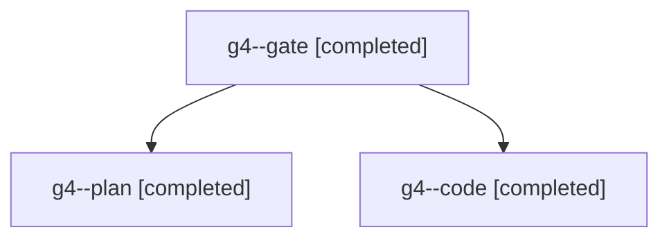

# Session: g4

[Agent Hoods](../README.md) / [bbugyi200](../users/bbugyi200/README.md) / [apollo](../users/bbugyi200/machines/apollo/README.md) / [g4](../users/bbugyi200/machines/apollo/hoods/g4/README.md) / g4

Owner: `bbugyi200.apollo` · Hood: `g4` · Members: 3

## Lineage



The diagram is an optional enhancement; the ordered table below contains the same lineage in accessible text.

| Role | Agent | State | Model / provider | Timing | Commits | Prompt | Chat |
|---|---|---|---|---|---:|---|---|
| <a id="member-gate"></a>gate | g4--gate | completed | opus / claude | 2026-11-26T17:12:46.420245+00:00 → 2026-11-26T17:13:21.903736+00:00 | 0 | — | [Chat](../agents/bbugyi200.apollo.g4--gate/chat.md) |
| <a id="member-plan"></a>plan | g4--plan | completed | opus / claude | 2026-11-26T16:21:34.978866+00:00 → 2026-11-26T16:30:16.896192+00:00 | 0 | [Prompt](../agents/bbugyi200.apollo.g4--plan/prompt.md) | [Chat](../agents/bbugyi200.apollo.g4--plan/chat.md) |
| <a id="member-code"></a>code | g4--code | completed | gpt-6-luna / codex | 2026-11-26T17:14:04.980736+00:00 → 2026-11-26T18:47:09.111947+00:00 | [1](../agents/bbugyi200.apollo.g4--code/README.md#commits) | [Prompt](../agents/bbugyi200.apollo.g4--code/prompt.md) | [Chat](../agents/bbugyi200.apollo.g4--code/chat.md) |

## Commits

| Role | Repo | Commit | Subject | Committed |
|---|---|---|---|---|
| code | bob-cli | [`c261c6a`](https://github.com/bobs-org/bob-cli/commit/c261c6a35dc69dc5ace384d29417f7d40a48525d) | feat(capture): file notes from existing-task links | 2026-11-26 13:46:36 EST |

## Variables

| Role | Variable | Value |
|---|---|---|
| code | `artifacts` | \[{kind: file, label: bob-cli just check failure log 2026-11-26, path: /home/bryan/.sase/artifacts/agents/gh\_bobs-org\_\_bob-cli/20261126121321/stdout-6faa8dc58316.log, ref: file:explicit:1ab145e7f3b123… |

#### artifacts

**Role:** `code`

```yaml
- kind: file
  label: bob-cli just check failure log 2026-11-26
  path: /home/bryan/.sase/artifacts/agents/gh_bobs-org__bob-cli/20261126121321/stdout-6faa8dc58316.log
  ref: file:explicit:1ab145e7f3b1233e189893e2
  source_path: /home/bryan/.sase/tools/logs/52eb19a1f3e85184331398d453613402/stdout.log
- kind: file
  label: bob-cli docs-check stale mount collision 2026-11-26
  path: /home/bryan/.sase/artifacts/agents/gh_bobs-org__bob-cli/20261126121321/bob-cli-docs-check-failure-2026-11-26-6402a7334526.log
  ref: file:explicit:447de1fa045a4bc1a4da61c9
  source_path: /tmp/bob-cli-docs-check-failure-2026-11-26.log
```

Values are truncated for display; see each member's agent meta.json for the full values.
