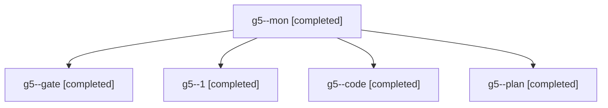

# Session: g5

[Agent Hoods](../README.md) / [bbugyi200](../users/bbugyi200/README.md) / [apollo](../users/bbugyi200/machines/apollo/README.md) / [g5](../users/bbugyi200/machines/apollo/hoods/g5/README.md) / g5

Owner: `bbugyi200.apollo` · Hood: `g5` · Members: 5

## Lineage



The diagram is an optional enhancement; the ordered table below contains the same lineage in accessible text.

| Role | Agent | State | Model / provider | Timing | Commits | Prompt | Chat |
|---|---|---|---|---|---:|---|---|
| <a id="member-mon"></a>mon | g5--mon | completed | muse-spark-1.3-contributor / muse | 2026-11-26T19:20:27.820169+00:00 → 2026-11-26T19:25:18.193555+00:00 | 0 | — | [Chat](../agents/bbugyi200.apollo.g5--mon/chat.md) |
| <a id="member-gate"></a>gate | g5--gate | completed | opus / claude | 2026-11-26T18:33:22.424422+00:00 → 2026-11-26T18:34:41.770171+00:00 | 0 | — | [Chat](../agents/bbugyi200.apollo.g5--gate/chat.md) |
| <a id="member-1"></a>1 | g5--1 | completed | muse-spark-1.3-contributor / muse | 2026-11-26T19:25:18.068608+00:00 → 2026-11-26T19:30:34.463164+00:00 | 0 | [Prompt](../agents/bbugyi200.apollo.g5--1/prompt.md) | [Chat](../agents/bbugyi200.apollo.g5--1/chat.md) |
| <a id="member-code"></a>code | g5--code | completed | muse-spark-1.3-contributor / muse | 2026-11-26T18:35:29.941696+00:00 → 2026-11-26T19:23:11.678054+00:00 | [1](../agents/bbugyi200.apollo.g5--code/README.md#commits) | [Prompt](../agents/bbugyi200.apollo.g5--code/prompt.md) | [Chat](../agents/bbugyi200.apollo.g5--code/chat.md) |
| <a id="member-plan"></a>plan | g5--plan | completed | opus / claude | 2026-11-26T18:20:58.719744+00:00 → 2026-11-26T18:32:38.285840+00:00 | 0 | [Prompt](../agents/bbugyi200.apollo.g5--plan/prompt.md) | [Chat](../agents/bbugyi200.apollo.g5--plan/chat.md) |

## Commits

| Role | Repo | Commit | Subject | Committed |
|---|---|---|---|---|
| code | bob-cli | [`d9c0d72`](https://github.com/bobs-org/bob-cli/commit/d9c0d728257f30be38ebf9e4d85df08c12393eda) | docs(task-drawers): note widened 0.9em tray span for bob-cli-ph | 2026-11-26 14:22:21 EST |

## Variables

| Role | Variable | Value |
|---|---|---|
| code | `artifacts` | \[{bead: bob-cli-ph, kind: image, label: drawers-light-live.png, path: /home/bryan/.sase/artifacts/agents/gh\_bobs-org\_\_bob-cli/20261126133440/drawers-light-live-849d725e834c.png, ref: file:explicit:bb… |

#### artifacts

**Role:** `code`

```yaml
- bead: bob-cli-ph
  kind: image
  label: drawers-light-live.png
  path: /home/bryan/.sase/artifacts/agents/gh_bobs-org__bob-cli/20261126133440/drawers-light-live-849d725e834c.png
  ref: file:explicit:bb0bc67398d9276f18381bcd
  source_path: /tmp/close_true_case_drawers_20261126_183956/drawers-light-live.png
- bead: bob-cli-ph
  kind: image
  label: drawers-light-reading.png
  path: /home/bryan/.sase/artifacts/agents/gh_bobs-org__bob-cli/20261126133440/drawers-light-reading-7cb2275ceb59.png
  ref: file:explicit:42632fd4b640749925a821fb
  source_path: /tmp/close_true_case_drawers_20261126_183956/drawers-light-reading.png
- bead: bob-cli-ph
  kind: image
  label: drawers-dark-live.png
  path: /home/bryan/.sase/artifacts/agents/gh_bobs-org__bob-cli/20261126133440/drawers-dark-live-fb9d0182ea1f.png
  ref: file:explicit:67c95bbcb7fee397f4604d49
  source_path: /tmp/close_true_case_drawers_20261126_183956/drawers-dark-live.png
```

Values are truncated for display; see each member's agent meta.json for the full values.
