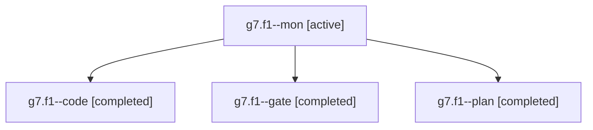

# Session: g7.f1

[Agent Hoods](../README.md) / [bbugyi200](../users/bbugyi200/README.md) / [apollo](../users/bbugyi200/machines/apollo/README.md) / [g7](../users/bbugyi200/machines/apollo/hoods/g7/README.md) / g7.f1

Owner: `bbugyi200.apollo` · Hood: `g7` · Members: 4

## Lineage

The diagram is an optional enhancement; the ordered table below contains the same lineage in accessible text.

| Role | Agent | State | Model / provider | Timing | Commits | Prompt | Chat |
|---|---|---|---|---|---:|---|---|
| mon | g7.f1--mon | active | grok-4.6 / grok | 2026-11-28T00:17:57.050929+00:00 | 0 | — | — |
| code | g7.f1--code | completed | grok-4.6 / grok | 2026-11-27T23:52:33.072693+00:00 → 2026-11-28T00:19:51.139967+00:00 | 0 | [Prompt](../agents/bbugyi200.apollo.g7.f1--code/prompt.md) | [Chat](../agents/bbugyi200.apollo.g7.f1--code/chat.md) |
| gate | g7.f1--gate | completed | opus / claude | 2026-11-27T23:51:33.796578+00:00 → 2026-11-27T23:52:05.819686+00:00 | 0 | — | [Chat](../agents/bbugyi200.apollo.g7.f1--gate/chat.md) |
| plan | g7.f1--plan | completed | opus / claude | 2026-11-27T23:19:55.992610+00:00 → 2026-11-27T23:32:21.176859+00:00 | 0 | [Prompt](../agents/bbugyi200.apollo.g7.f1--plan/prompt.md) | [Chat](../agents/bbugyi200.apollo.g7.f1--plan/chat.md) |

## Neighbors

| Agent | Relation | State |
|---|---|---|
| [g7](bbugyi200.apollo.g7.md) (session · 3) | ancestor | completed 3 |
| [g7.f0](../agents/bbugyi200.apollo.g7.f0/README.md) | g7 hood | active |
