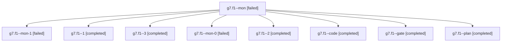

# Session: g7.f1

[Agent Hoods](../README.md) / [bbugyi200](../users/bbugyi200/README.md) / [apollo](../users/bbugyi200/machines/apollo/README.md) / [g7](../users/bbugyi200/machines/apollo/hoods/g7/README.md) / g7.f1

Owner: `bbugyi200.apollo` · Hood: `g7` · Members: 9

## Lineage



The diagram is an optional enhancement; the ordered table below contains the same lineage in accessible text.

| Role | Agent | State | Model / provider | Timing | Commits | Prompt | Chat |
|---|---|---|---|---|---:|---|---|
| <a id="member-mon"></a>mon | g7.f1--mon | failed | grok-4.6 / grok | 2026-11-28T00:17:57.050929+00:00 → 2026-11-28T00:23:58.274117+00:00 | 0 | — | [Chat](../agents/bbugyi200.apollo.g7.f1--mon/chat.md) |
| <a id="member-mon-1"></a>mon-1 | g7.f1--mon-1 | failed | grok-4.6 / grok | 2026-11-28T01:01:45.548625+00:00 → 2026-11-28T01:09:10.825957+00:00 | 0 | — | — |
| <a id="member-1"></a>1 | g7.f1--1 | completed | grok-4.6 / grok | 2026-11-28T00:23:57.863274+00:00 → 2026-11-28T00:31:21.068190+00:00 | 0 | [Prompt](../agents/bbugyi200.apollo.g7.f1--1/prompt.md) | [Chat](../agents/bbugyi200.apollo.g7.f1--1/chat.md) |
| <a id="member-3"></a>3 | g7.f1--3 | completed | grok-4.6 / grok | 2026-11-28T01:09:10.630520+00:00 → 2026-11-28T01:26:26.214242+00:00 | 0 | — | — |
| <a id="member-mon-0"></a>mon-0 | g7.f1--mon-0 | failed | grok-4.6 / grok | 2026-11-28T00:30:17.441473+00:00 → 2026-11-28T00:37:31.748053+00:00 | 0 | — | — |
| <a id="member-2"></a>2 | g7.f1--2 | completed | grok-4.6 / grok | 2026-11-28T00:37:31.503924+00:00 → 2026-11-28T01:03:33.094945+00:00 | 0 | — | — |
| <a id="member-code"></a>code | g7.f1--code | completed | grok-4.6 / grok | 2026-11-27T23:52:33.072693+00:00 → 2026-11-28T00:19:51.139967+00:00 | 0 | [Prompt](../agents/bbugyi200.apollo.g7.f1--code/prompt.md) | [Chat](../agents/bbugyi200.apollo.g7.f1--code/chat.md) |
| <a id="member-gate"></a>gate | g7.f1--gate | completed | opus / claude | 2026-11-27T23:51:33.796578+00:00 → 2026-11-27T23:52:05.819686+00:00 | 0 | — | [Chat](../agents/bbugyi200.apollo.g7.f1--gate/chat.md) |
| <a id="member-plan"></a>plan | g7.f1--plan | completed | opus / claude | 2026-11-27T23:19:55.992610+00:00 → 2026-11-27T23:32:21.176859+00:00 | 0 | [Prompt](../agents/bbugyi200.apollo.g7.f1--plan/prompt.md) | [Chat](../agents/bbugyi200.apollo.g7.f1--plan/chat.md) |

## Variables

| Role | Variable | Value |
|---|---|---|
| 3 | `artifacts` | \[{bead: bob-cli-qq, kind: file, label: cabinets GO-2 1.174.2 report (NO-GO), path: /home/bryan/.sase/artifacts/agents/gh\_bobs-org\_\_bob-cli/20261127200820/cabinets-e2e-ebfc00a3c120.json, ref: file:exp… |

#### artifacts

**Role:** `3`

```yaml
- bead: bob-cli-qq
  kind: file
  label: cabinets GO-2 1.174.2 report (NO-GO)
  path: /home/bryan/.sase/artifacts/agents/gh_bobs-org__bob-cli/20261127200820/cabinets-e2e-ebfc00a3c120.json
  ref: file:explicit:415c27411b93bc22877d0ac9
  source_path: /tmp/cabinets-e2e-11742/cabinets-e2e.json
- bead: bob-cli-qq
  kind: markdown
  label: cabinets GO-2 1.174.2 acceptance review (NO-GO)
  path: /home/bryan/.sase/artifacts/agents/gh_bobs-org__bob-cli/20261127200820/acceptance-review-42575547ef8c.md
  ref: file:explicit:e9a1f8d6435f5e75760635ef
  source_path: /tmp/cabinets-e2e-11742/acceptance-review.md
- bead: bob-cli-qq
  kind: file
  label: cabinets GO-2 1.174.2 screenshots (70 PNG, NO-GO)
  path: /home/bryan/.sase/artifacts/agents/gh_bobs-org__bob-cli/20261127200820/shots.tar-aec6fb634564.gz
  ref: file:explicit:ba9d720edea669b9c2079a0e
  source_path: /tmp/cabinets-e2e-11742/shots.tar.gz
```

Values are truncated for display; see each member's agent meta.json for the full values.

## Neighbors

| Agent | Relation | State |
|---|---|---|
| [g7](bbugyi200.apollo.g7.md) (session · 3) | ancestor | completed 3 |
| [g7.f0](../agents/bbugyi200.apollo.g7.f0/README.md) | g7 hood | active |
