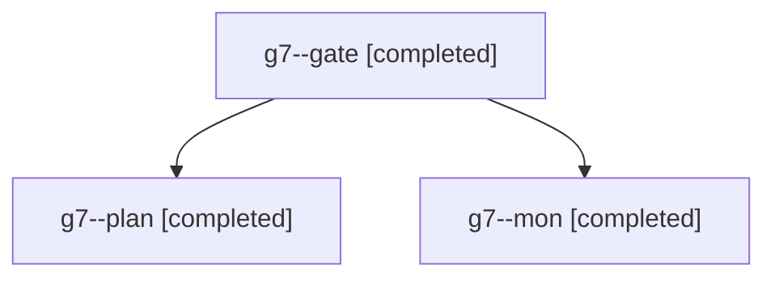

# Session: g7

[Agent Hoods](../README.md) / [bbugyi200](../users/bbugyi200/README.md) / [apollo](../users/bbugyi200/machines/apollo/README.md) / [g7](../users/bbugyi200/machines/apollo/hoods/g7/README.md) / g7

Owner: `bbugyi200.apollo` · Hood: `g7` · Members: 3

## Lineage

The diagram is an optional enhancement; the ordered table below contains the same lineage in accessible text.

| Role | Agent | State | Model / provider | Timing | Commits | Prompt | Chat |
|---|---|---|---|---|---:|---|---|
| gate | g7--gate | completed | opus / claude | 2026-11-27T14:11:41.440501+00:00 → 2026-11-27T14:12:17.815859+00:00 | 0 | — | [Chat](../agents/bbugyi200.apollo.g7--gate/chat.md) |
| plan | g7--plan | completed | opus / claude | 2026-11-27T13:55:48.462208+00:00 → 2026-11-27T14:11:09.363080+00:00 | 0 | [Prompt](../agents/bbugyi200.apollo.g7--plan/prompt.md) | [Chat](../agents/bbugyi200.apollo.g7--plan/chat.md) |
| mon | g7--mon | completed | opus / claude | 2026-11-27T14:12:05.655058+00:00 → 2026-11-27T14:17:14.218452+00:00 | 0 | — | [Chat](../agents/bbugyi200.apollo.g7--mon/chat.md) |

## Neighbors

| Agent | Relation | State |
|---|---|---|
| [g7.f0](../agents/bbugyi200.apollo.g7.f0/README.md) | descendant | active |
| [g7.f1](bbugyi200.apollo.g7.f1.md) (session · 8) | descendant | active 1, completed 5, failed 2 |
