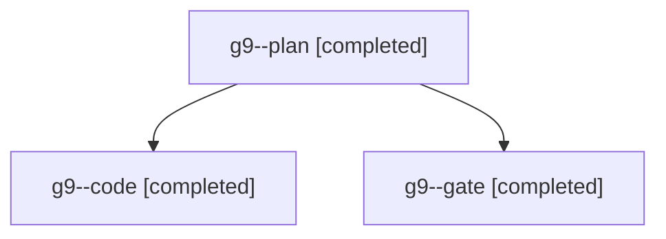

# Session: g9

[Agent Hoods](../README.md) / [bbugyi200](../users/bbugyi200/README.md) / [apollo](../users/bbugyi200/machines/apollo/README.md) / [g9](../users/bbugyi200/machines/apollo/hoods/g9/README.md) / g9

Owner: `bbugyi200.apollo` · Hood: `g9` · Members: 3

## Lineage

The diagram is an optional enhancement; the ordered table below contains the same lineage in accessible text.

| Role | Agent | State | Model / provider | Timing | Commits | Prompt | Chat |
|---|---|---|---|---|---:|---|---|
| plan | g9--plan | completed | opus / claude | 2026-11-28T15:23:48.433175+00:00 → 2026-11-28T15:37:15.944841+00:00 | 0 | [Prompt](../agents/bbugyi200.apollo.g9--plan/prompt.md) | [Chat](../agents/bbugyi200.apollo.g9--plan/chat.md) |
| code | g9--code | completed | muse-spark-1.3-contributor / muse | 2026-11-28T15:40:09.025114+00:00 → 2026-11-28T16:01:22.273678+00:00 | 0 | [Prompt](../agents/bbugyi200.apollo.g9--code/prompt.md) | [Chat](../agents/bbugyi200.apollo.g9--code/chat.md) |
| gate | g9--gate | completed | opus / claude | 2026-11-28T15:37:31.653249+00:00 → 2026-11-28T15:39:45.712138+00:00 | 0 | — | [Chat](../agents/bbugyi200.apollo.g9--gate/chat.md) |
