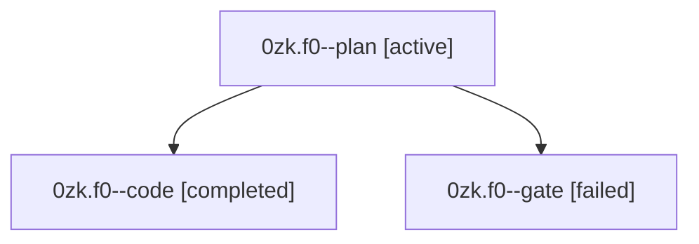

# Session: 0zk.f0

[Agent Hoods](../README.md) / [bbugyi200](../users/bbugyi200/README.md) / [athena](../users/bbugyi200/machines/athena/README.md) / [0zk](../users/bbugyi200/machines/athena/hoods/0zk/README.md) / 0zk.f0

Owner: `bbugyi200.athena` · Hood: `0zk` · Members: 3

## Lineage

The diagram is an optional enhancement; the ordered table below contains the same lineage in accessible text.

| Role | Agent | State | Model / provider | Timing | Commits | Prompt | Chat |
|---|---|---|---|---|---:|---|---|
| plan | 0zk.f0--plan | active | opus / claude | 2026-10-11T11:29:46.035785+00:00 | 0 | [Prompt](../agents/bbugyi200.athena.0zk.f0--plan/prompt.md) | [Chat](../agents/bbugyi200.athena.0zk.f0--plan/chat.md) |
| code | 0zk.f0--code | completed | muse-spark-1.3-contributor / muse | 2026-10-11T12:33:21.427607+00:00 → 2026-10-11T12:49:43.201672+00:00 | 0 | — | — |
| gate | 0zk.f0--gate | failed | opus / claude | 2026-10-11T12:32:21.629678+00:00 → 2026-10-11T12:33:00.965627+00:00 | 0 | — | [Chat](../agents/bbugyi200.athena.0zk.f0--gate/chat.md) |

## Neighbors

| Agent | Relation | State |
|---|---|---|
| [0zk](bbugyi200.athena.0zk.md) (session · 3) | ancestor | completed 2, failed 1 |
