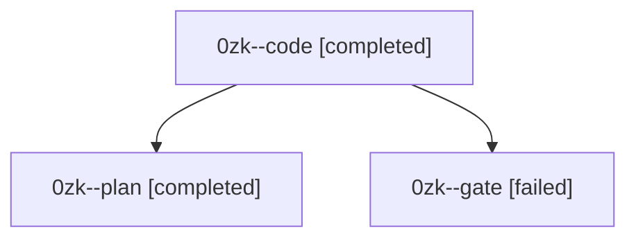

# Session: 0zk

[Agent Hoods](../README.md) / [bbugyi200](../users/bbugyi200/README.md) / [athena](../users/bbugyi200/machines/athena/README.md) / [0zk](../users/bbugyi200/machines/athena/hoods/0zk/README.md) / 0zk

Owner: `bbugyi200.athena` · Hood: `0zk` · Members: 3

## Lineage

The diagram is an optional enhancement; the ordered table below contains the same lineage in accessible text.

| Role | Agent | State | Model / provider | Timing | Commits | Prompt | Chat |
|---|---|---|---|---|---:|---|---|
| code | 0zk--code | completed | sonnet / claude | 2026-10-11T11:03:53.375537+00:00 → 2026-10-11T11:14:20.508421+00:00 | 0 | — | [Chat](../agents/bbugyi200.athena.0zk--code/chat.md) |
| plan | 0zk--plan | completed | gpt-6-astra / codex | 2026-10-11T10:58:44.485663+00:00 → 2026-10-11T11:14:20.508421+00:00 | 0 | [Prompt](../agents/bbugyi200.athena.0zk--plan/prompt.md) | [Chat](../agents/bbugyi200.athena.0zk--plan/chat.md) |
| gate | 0zk--gate | failed | gpt-6-astra / codex | 2026-10-11T11:03:11.834258+00:00 → 2026-10-11T11:03:35.835378+00:00 | 0 | — | [Chat](../agents/bbugyi200.athena.0zk--gate/chat.md) |

## Neighbors

| Agent | Relation | State |
|---|---|---|
| [0zk.f0](bbugyi200.athena.0zk.f0.md) (session · 3) | descendant | active 2, failed 1 |
