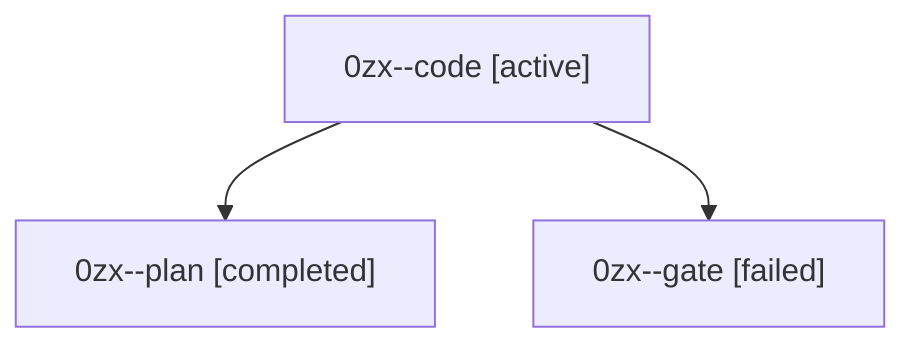

# Session: 0zx

[Agent Hoods](../README.md) / [bbugyi200](../users/bbugyi200/README.md) / [athena](../users/bbugyi200/machines/athena/README.md) / [0zx](../users/bbugyi200/machines/athena/hoods/0zx/README.md) / 0zx

Owner: `bbugyi200.athena` · Hood: `0zx` · Members: 3

## Lineage

The diagram is an optional enhancement; the ordered table below contains the same lineage in accessible text.

| Role | Agent | State | Model / provider | Timing | Commits | Prompt | Chat |
|---|---|---|---|---|---:|---|---|
| code | 0zx--code | active | muse-spark-1.3-contributor / muse | 2026-10-13T10:46:50.644854+00:00 | [1](../agents/bbugyi200.athena.0zx--code/README.md#commits) | [Prompt](../agents/bbugyi200.athena.0zx--code/prompt.md) | — |
| plan | 0zx--plan | completed | opus / claude | 2026-10-13T10:39:06.424265+00:00 → 2026-10-13T10:45:23.546293+00:00 | 0 | [Prompt](../agents/bbugyi200.athena.0zx--plan/prompt.md) | [Chat](../agents/bbugyi200.athena.0zx--plan/chat.md) |
| gate | 0zx--gate | failed | opus / claude | 2026-10-13T10:43:41.845123+00:00 → 2026-10-13T10:46:09.236252+00:00 | 0 | — | [Chat](../agents/bbugyi200.athena.0zx--gate/chat.md) |

## Commits

| Role | Repo | Commit | Subject | Committed |
|---|---|---|---|---|
| code | bob-cli | [`576a3e0`](https://github.com/bobs-org/bob-cli/commit/576a3e04a00f4fb17f0309c4a0dfc5eabdfb82f2) | docs(stats): document how stats block resolves bob home binary | 2026-10-13 06:52:01 EDT |
