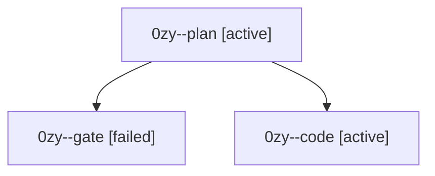

# Session: 0zy

[Agent Hoods](../README.md) / [bbugyi200](../users/bbugyi200/README.md) / [athena](../users/bbugyi200/machines/athena/README.md) / [0zy](../users/bbugyi200/machines/athena/hoods/0zy/README.md) / 0zy

Owner: `bbugyi200.athena` · Hood: `0zy` · Members: 3

## Lineage

The diagram is an optional enhancement; the ordered table below contains the same lineage in accessible text.

| Role | Agent | State | Model / provider | Timing | Commits | Prompt | Chat |
|---|---|---|---|---|---:|---|---|
| plan | 0zy--plan | active | opus / claude | 2026-10-13T14:27:50.188524+00:00 | 0 | [Prompt](../agents/bbugyi200.athena.0zy--plan/prompt.md) | [Chat](../agents/bbugyi200.athena.0zy--plan/chat.md) |
| gate | 0zy--gate | failed | opus / claude | 2026-10-13T14:45:11.019225+00:00 → 2026-10-13T14:45:37.274989+00:00 | 0 | — | [Chat](../agents/bbugyi200.athena.0zy--gate/chat.md) |
| code | 0zy--code | active | muse-spark-1.3-contributor / muse | 2026-10-13T14:45:58.798702+00:00 | 0 | — | — |

## Neighbors

| Agent | Relation | State |
|---|---|---|
| [0zy.w0](../agents/bbugyi200.athena.0zy.w0/README.md) | descendant | waiting |
