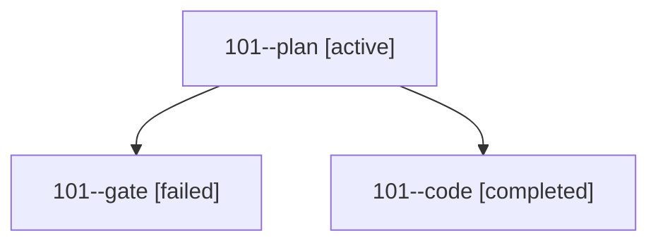

# Session: 101

[Agent Hoods](../README.md) / [bbugyi200](../users/bbugyi200/README.md) / [athena](../users/bbugyi200/machines/athena/README.md) / [101](../users/bbugyi200/machines/athena/hoods/101/README.md) / 101

Owner: `bbugyi200.athena` · Hood: `101` · Members: 3

## Lineage

The diagram is an optional enhancement; the ordered table below contains the same lineage in accessible text.

| Role | Agent | State | Model / provider | Timing | Commits | Prompt | Chat |
|---|---|---|---|---|---:|---|---|
| plan | 101--plan | active | opus / claude | 2026-10-13T15:13:35.600519+00:00 | 0 | [Prompt](../agents/bbugyi200.athena.101--plan/prompt.md) | [Chat](../agents/bbugyi200.athena.101--plan/chat.md) |
| gate | 101--gate | failed | opus / claude | 2026-10-13T15:26:11.036117+00:00 → 2026-10-13T15:26:36.753550+00:00 | 0 | — | [Chat](../agents/bbugyi200.athena.101--gate/chat.md) |
| code | 101--code | completed | muse-spark-1.3-contributor / muse | 2026-10-13T15:27:03.251404+00:00 → 2026-10-13T15:43:04.730013+00:00 | 0 | — | — |
