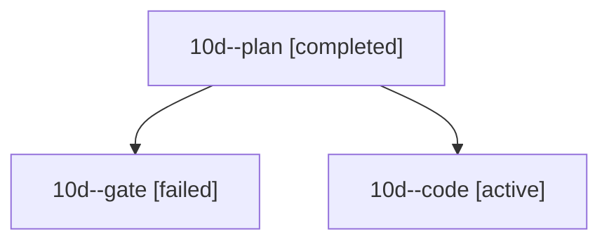

# Session: 10d

[Agent Hoods](../README.md) / [bbugyi200](../users/bbugyi200/README.md) / [athena](../users/bbugyi200/machines/athena/README.md) / [10d](../users/bbugyi200/machines/athena/hoods/10d/README.md) / 10d

Owner: `bbugyi200.athena` · Hood: `10d` · Members: 3

## Lineage

The diagram is an optional enhancement; the ordered table below contains the same lineage in accessible text.

| Role | Agent | State | Model / provider | Timing | Commits | Prompt | Chat |
|---|---|---|---|---|---:|---|---|
| plan | 10d--plan | completed | opus / claude | 2026-10-14T13:56:44.049425+00:00 → 2026-10-14T14:02:53.706583+00:00 | 0 | [Prompt](../agents/bbugyi200.athena.10d--plan/prompt.md) | [Chat](../agents/bbugyi200.athena.10d--plan/chat.md) |
| gate | 10d--gate | failed | opus / claude | 2026-10-14T14:04:37.085136+00:00 → 2026-10-14T14:06:14.174669+00:00 | 0 | — | [Chat](../agents/bbugyi200.athena.10d--gate/chat.md) |
| code | 10d--code | active | gpt-6-luna / codex | 2026-10-14T14:07:01.265295+00:00 | [1](../agents/bbugyi200.athena.10d--code/README.md#commits) | [Prompt](../agents/bbugyi200.athena.10d--code/prompt.md) | — |

## Commits

| Role | Repo | Commit | Subject | Committed |
|---|---|---|---|---|
| code | bob-cli | [`23bee1f`](https://github.com/bobs-org/bob-cli/commit/23bee1f90dd6d3470585e2f0679f08a417d68997) | docs(task-dependencies): document linked note focus | 2026-10-14 10:14:14 EDT |
