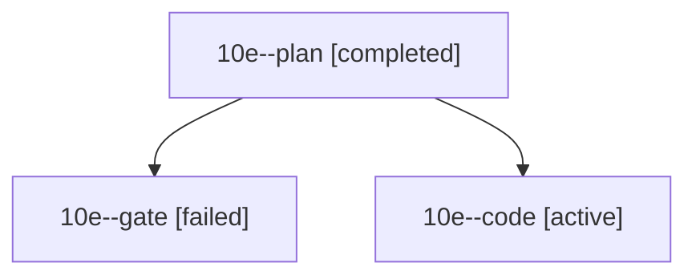

# Session: 10e

[Agent Hoods](../README.md) / [bbugyi200](../users/bbugyi200/README.md) / [athena](../users/bbugyi200/machines/athena/README.md) / [10e](../users/bbugyi200/machines/athena/hoods/10e/README.md) / 10e

Owner: `bbugyi200.athena` · Hood: `10e` · Members: 3

## Lineage

The diagram is an optional enhancement; the ordered table below contains the same lineage in accessible text.

| Role | Agent | State | Model / provider | Timing | Commits | Prompt | Chat |
|---|---|---|---|---|---:|---|---|
| plan | 10e--plan | completed | opus / claude | 2026-10-14T14:33:37.618523+00:00 → 2026-10-14T14:41:44.494054+00:00 | 0 | [Prompt](../agents/bbugyi200.athena.10e--plan/prompt.md) | [Chat](../agents/bbugyi200.athena.10e--plan/chat.md) |
| gate | 10e--gate | failed | opus / claude | 2026-10-14T14:43:32.707655+00:00 → 2026-10-14T14:44:14.848255+00:00 | 0 | — | [Chat](../agents/bbugyi200.athena.10e--gate/chat.md) |
| code | 10e--code | active | grok-4.6 / grok | 2026-10-14T14:44:51.455661+00:00 | [1](../agents/bbugyi200.athena.10e--code/README.md#commits) | [Prompt](../agents/bbugyi200.athena.10e--code/prompt.md) | — |

## Commits

| Role | Repo | Commit | Subject | Committed |
|---|---|---|---|---|
| code | bob-cli | [`b4edb9b`](https://github.com/bobs-org/bob-cli/commit/b4edb9bb56b4d4828ab5ba3076f38bffe4f0f329) | docs(task-dependencies): document Ctrl+Shift+B | 2026-10-14 11:00:04 EDT |
