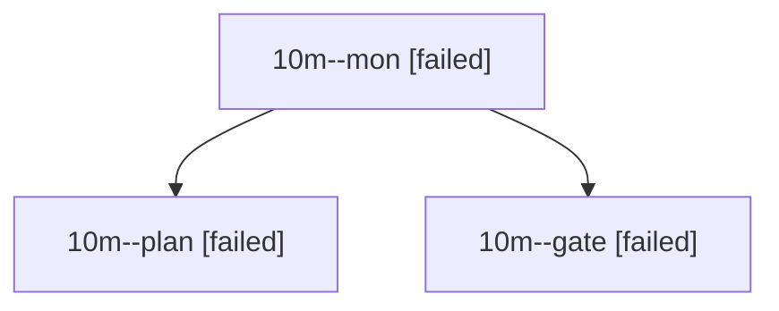

# Session: 10m

[Agent Hoods](../README.md) / [bbugyi200](../users/bbugyi200/README.md) / [athena](../users/bbugyi200/machines/athena/README.md) / [10m](../users/bbugyi200/machines/athena/hoods/10m/README.md) / 10m

Owner: `bbugyi200.athena` · Hood: `10m` · Members: 3

## Lineage

The diagram is an optional enhancement; the ordered table below contains the same lineage in accessible text.

| Role | Agent | State | Model / provider | Timing | Commits | Prompt | Chat |
|---|---|---|---|---|---:|---|---|
| mon | 10m--mon | failed | opus / claude | 2026-10-16T11:28:54.695929+00:00 → 2026-10-16T11:31:25.267915+00:00 | 0 | — | [Chat](../agents/bbugyi200.athena.10m--mon/chat.md) |
| plan | 10m--plan | failed | opus / claude | 2026-10-16T11:12:42.017438+00:00 → 2026-10-16T11:29:03.194130+00:00 | 0 | [Prompt](../agents/bbugyi200.athena.10m--plan/prompt.md) | [Chat](../agents/bbugyi200.athena.10m--plan/chat.md) |
| gate | 10m--gate | failed | opus / claude | 2026-10-16T11:28:27.430474+00:00 → 2026-10-16T11:28:55.490369+00:00 | 0 | — | [Chat](../agents/bbugyi200.athena.10m--gate/chat.md) |
