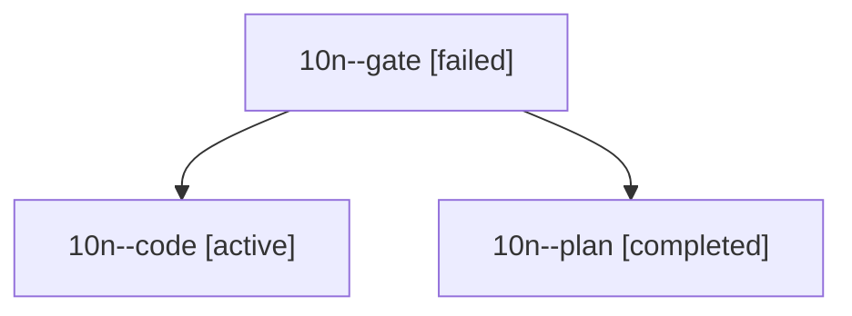

# Session: 10n

[Agent Hoods](../README.md) / [bbugyi200](../users/bbugyi200/README.md) / [athena](../users/bbugyi200/machines/athena/README.md) / [10n](../users/bbugyi200/machines/athena/hoods/10n/README.md) / 10n

Owner: `bbugyi200.athena` · Hood: `10n` · Members: 3

## Lineage

The diagram is an optional enhancement; the ordered table below contains the same lineage in accessible text.

| Role | Agent | State | Model / provider | Timing | Commits | Prompt | Chat |
|---|---|---|---|---|---:|---|---|
| gate | 10n--gate | failed | opus / claude | 2026-10-16T13:03:45.481422+00:00 → 2026-10-16T13:04:26.142580+00:00 | 0 | — | [Chat](../agents/bbugyi200.athena.10n--gate/chat.md) |
| code | 10n--code | active | muse-spark-1.3-contributor / muse | 2026-10-16T13:05:05.474150+00:00 | 0 | [Prompt](../agents/bbugyi200.athena.10n--code/prompt.md) | — |
| plan | 10n--plan | completed | opus / claude | 2026-10-16T12:34:15.211707+00:00 → 2026-10-16T12:41:31.804471+00:00 | 0 | [Prompt](../agents/bbugyi200.athena.10n--plan/prompt.md) | [Chat](../agents/bbugyi200.athena.10n--plan/chat.md) |
