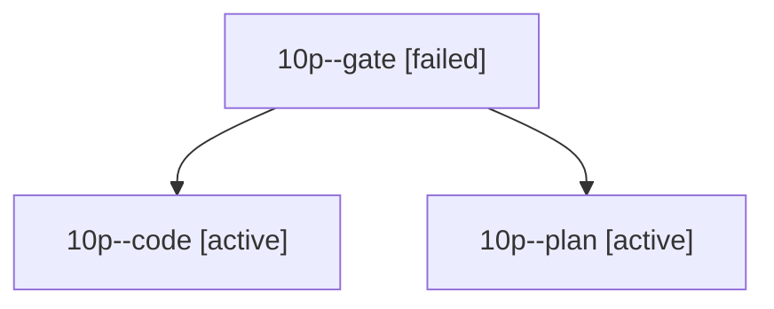

# Session: 10p

[Agent Hoods](../README.md) / [bbugyi200](../users/bbugyi200/README.md) / [athena](../users/bbugyi200/machines/athena/README.md) / [10p](../users/bbugyi200/machines/athena/hoods/10p/README.md) / 10p

Owner: `bbugyi200.athena` · Hood: `10p` · Members: 3

## Lineage

The diagram is an optional enhancement; the ordered table below contains the same lineage in accessible text.

| Role | Agent | State | Model / provider | Timing | Commits | Prompt | Chat |
|---|---|---|---|---|---:|---|---|
| gate | 10p--gate | failed | opus / claude | 2026-10-16T16:00:06.212242+00:00 → 2026-10-16T16:00:41.317447+00:00 | 0 | — | [Chat](../agents/bbugyi200.athena.10p--gate/chat.md) |
| code | 10p--code | active | grok-4.6 / grok | 2026-10-16T16:01:02.579309+00:00 | 0 | — | — |
| plan | 10p--plan | active | opus / claude | 2026-10-16T15:51:23.000522+00:00 | 0 | [Prompt](../agents/bbugyi200.athena.10p--plan/prompt.md) | [Chat](../agents/bbugyi200.athena.10p--plan/chat.md) |
