# Session: 10v

[Agent Hoods](../README.md) / [bbugyi200](../users/bbugyi200/README.md) / [athena](../users/bbugyi200/machines/athena/README.md) / [10v](../users/bbugyi200/machines/athena/hoods/10v/README.md) / 10v

Owner: `bbugyi200.athena` · Hood: `10v` · Members: 15

## Lineage

```mermaid
flowchart TD
  n0["10v--3 [completed]"]
  n1["10v--gate [failed]"]
  n0 --> n1
  n2["10v--plan [completed]"]
  n0 --> n2
  n3["10v--mon-4 [failed]"]
  n0 --> n3
  n4["10v--mon-2 [failed]"]
  n0 --> n4
  n5["10v--6 [completed]"]
  n0 --> n5
  n6["10v--2 [completed]"]
  n0 --> n6
  n7["10v--mon [failed]"]
  n0 --> n7
  n8["10v--1 [completed]"]
  n0 --> n8
  n9["10v--code [completed]"]
  n0 --> n9
  n10["10v--mon-3 [failed]"]
  n0 --> n10
  n11["10v--4 [completed]"]
  n0 --> n11
  n12["10v--5 [completed]"]
  n0 --> n12
  n13["10v--mon-0 [failed]"]
  n0 --> n13
  n14["10v--mon-1 [failed]"]
  n0 --> n14
```

The diagram is an optional enhancement; the ordered table below contains the same lineage in accessible text.

| Role | Agent | State | Model / provider | Timing | Commits | Prompt | Chat |
|---|---|---|---|---|---:|---|---|
| 3 | 10v--3 | completed | gpt-6-luna / codex | 2026-10-17T11:36:12.160806+00:00 → 2026-10-17T11:40:56.592229+00:00 | 0 | [Prompt](../agents/bbugyi200.athena.10v--3/prompt.md) | [Chat](../agents/bbugyi200.athena.10v--3/chat.md) |
| gate | 10v--gate | failed | opus / claude | 2026-10-17T10:40:08.098740+00:00 → 2026-10-17T10:42:31.299965+00:00 | 0 | — | [Chat](../agents/bbugyi200.athena.10v--gate/chat.md) |
| plan | 10v--plan | completed | opus / claude | 2026-10-17T10:24:01.933570+00:00 → 2026-10-17T10:37:22.412674+00:00 | 0 | [Prompt](../agents/bbugyi200.athena.10v--plan/prompt.md) | [Chat](../agents/bbugyi200.athena.10v--plan/chat.md) |
| mon-4 | 10v--mon-4 | failed | gpt-6-luna / codex | 2026-10-17T12:03:04.020111+00:00 → 2026-10-17T12:05:14.143893+00:00 | 0 | — | [Chat](../agents/bbugyi200.athena.10v--mon-4/chat.md) |
| mon-2 | 10v--mon-2 | failed | gpt-6-luna / codex | 2026-10-17T11:40:10.947423+00:00 → 2026-10-17T11:42:43.998283+00:00 | 0 | — | [Chat](../agents/bbugyi200.athena.10v--mon-2/chat.md) |
| 6 | 10v--6 | completed | grok-4.6 / grok | 2026-10-17T12:05:49.052094+00:00 → 2026-10-17T12:14:09.222270+00:00 | [1](../agents/bbugyi200.athena.10v--6/README.md#commits) | [Prompt](../agents/bbugyi200.athena.10v--6/prompt.md) | — |
| 2 | 10v--2 | completed | gpt-6-luna / codex | 2026-10-17T11:28:39.473557+00:00 → 2026-10-17T11:33:27.127846+00:00 | 0 | [Prompt](../agents/bbugyi200.athena.10v--2/prompt.md) | [Chat](../agents/bbugyi200.athena.10v--2/chat.md) |
| mon | 10v--mon | failed | gpt-6-luna / codex | 2026-10-17T11:03:16.729650+00:00 → 2026-10-17T11:09:18.840175+00:00 | 0 | — | [Chat](../agents/bbugyi200.athena.10v--mon/chat.md) |
| 1 | 10v--1 | completed | gpt-6-luna / codex | 2026-10-17T11:12:17.174940+00:00 → 2026-10-17T11:22:25.795305+00:00 | 0 | [Prompt](../agents/bbugyi200.athena.10v--1/prompt.md) | [Chat](../agents/bbugyi200.athena.10v--1/chat.md) |
| code | 10v--code | completed | gpt-6-luna / codex | 2026-10-17T10:44:22.185033+00:00 → 2026-10-17T11:04:58.543053+00:00 | 0 | [Prompt](../agents/bbugyi200.athena.10v--code/prompt.md) | [Chat](../agents/bbugyi200.athena.10v--code/chat.md) |
| mon-3 | 10v--mon-3 | failed | gpt-6-luna / codex | 2026-10-17T11:51:36.504279+00:00 → 2026-10-17T11:58:22.187286+00:00 | 0 | — | [Chat](../agents/bbugyi200.athena.10v--mon-3/chat.md) |
| 4 | 10v--4 | completed | gpt-6-luna / codex | 2026-10-17T11:43:22.113653+00:00 → 2026-10-17T11:54:09.707254+00:00 | 0 | [Prompt](../agents/bbugyi200.athena.10v--4/prompt.md) | [Chat](../agents/bbugyi200.athena.10v--4/chat.md) |
| 5 | 10v--5 | completed | gpt-6-luna / codex | 2026-10-17T11:59:01.716006+00:00 → 2026-10-17T12:03:56.290909+00:00 | 0 | [Prompt](../agents/bbugyi200.athena.10v--5/prompt.md) | [Chat](../agents/bbugyi200.athena.10v--5/chat.md) |
| mon-0 | 10v--mon-0 | failed | gpt-6-luna / codex | 2026-10-17T11:20:44.486286+00:00 → 2026-10-17T11:28:02.713814+00:00 | 0 | — | [Chat](../agents/bbugyi200.athena.10v--mon-0/chat.md) |
| mon-1 | 10v--mon-1 | failed | gpt-6-luna / codex | 2026-10-17T11:32:44.710134+00:00 → 2026-10-17T11:35:35.825769+00:00 | 0 | — | [Chat](../agents/bbugyi200.athena.10v--mon-1/chat.md) |

## Commits

| Role | Repo | Commit | Subject | Committed |
|---|---|---|---|---|
| 6 | — | `5af6521` | feat(ref): re-key reference ids to the file stem on rename | 2026-10-17 08:12:34 EDT |
