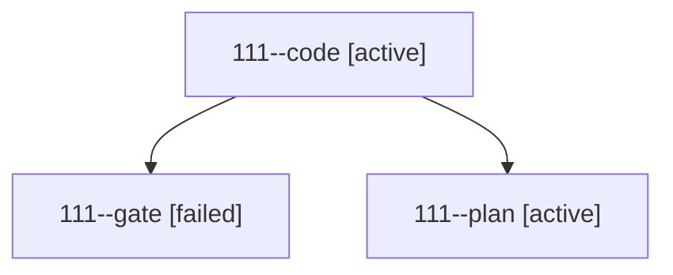

# Session: 111

[Agent Hoods](../README.md) / [bbugyi200](../users/bbugyi200/README.md) / [athena](../users/bbugyi200/machines/athena/README.md) / [111](../users/bbugyi200/machines/athena/hoods/111/README.md) / 111

Owner: `bbugyi200.athena` · Hood: `111` · Members: 3

## Lineage

The diagram is an optional enhancement; the ordered table below contains the same lineage in accessible text.

| Role | Agent | State | Model / provider | Timing | Commits | Prompt | Chat |
|---|---|---|---|---|---:|---|---|
| code | 111--code | active | gpt-6-luna / codex | 2026-10-17T16:22:39.292488+00:00 | [1](../agents/bbugyi200.athena.111--code/README.md#commits) | — | — |
| gate | 111--gate | failed | opus / claude | 2026-10-17T16:21:34.607333+00:00 → 2026-10-17T16:22:27.008710+00:00 | 0 | — | [Chat](../agents/bbugyi200.athena.111--gate/chat.md) |
| plan | 111--plan | active | opus / claude | 2026-10-17T16:04:33.304111+00:00 | 0 | [Prompt](../agents/bbugyi200.athena.111--plan/prompt.md) | [Chat](../agents/bbugyi200.athena.111--plan/chat.md) |

## Commits

| Role | Repo | Commit | Subject | Committed |
|---|---|---|---|---|
| code | bob-cli | [`c9a5063`](https://github.com/bobs-org/bob-cli/commit/c9a5063183542a7070079ac13d537c65627f867c) | docs(ref): document Highlights hotkey | 2026-10-17 12:35:06 EDT |
