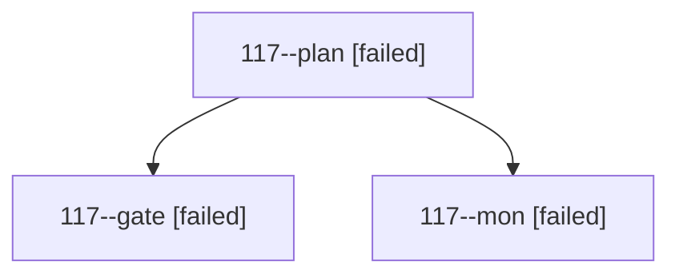

# Session: 117

[Agent Hoods](../README.md) / [bbugyi200](../users/bbugyi200/README.md) / [athena](../users/bbugyi200/machines/athena/README.md) / [117](../users/bbugyi200/machines/athena/hoods/117/README.md) / 117

Owner: `bbugyi200.athena` · Hood: `117` · Members: 3

## Lineage

The diagram is an optional enhancement; the ordered table below contains the same lineage in accessible text.

| Role | Agent | State | Model / provider | Timing | Commits | Prompt | Chat |
|---|---|---|---|---|---:|---|---|
| plan | 117--plan | failed | opus / claude | 2026-10-17T20:45:00.005814+00:00 → 2026-10-17T21:12:03.096889+00:00 | 0 | [Prompt](../agents/bbugyi200.athena.117--plan/prompt.md) | [Chat](../agents/bbugyi200.athena.117--plan/chat.md) |
| gate | 117--gate | failed | opus / claude | 2026-10-17T21:10:08.080141+00:00 → 2026-10-17T21:11:54.766651+00:00 | 0 | — | [Chat](../agents/bbugyi200.athena.117--gate/chat.md) |
| mon | 117--mon | failed | opus / claude | 2026-10-17T21:11:54.126148+00:00 → 2026-10-17T21:16:00.238768+00:00 | 0 | — | [Chat](../agents/bbugyi200.athena.117--mon/chat.md) |
