# Session: 11d

[Agent Hoods](../README.md) / [bbugyi200](../users/bbugyi200/README.md) / [athena](../users/bbugyi200/machines/athena/README.md) / [11d](../users/bbugyi200/machines/athena/hoods/11d/README.md) / 11d

Owner: `bbugyi200.athena` · Hood: `11d` · Members: 23

## Lineage

```mermaid
flowchart TD
  n0["11d--mon-4 [failed]"]
  n1["11d--code [completed]"]
  n0 --> n1
  n2["11d--mon-3 [failed]"]
  n0 --> n2
  n3["11d--3 [completed]"]
  n0 --> n3
  n4["11d--1 [completed]"]
  n0 --> n4
  n5["11d--5 [completed]"]
  n0 --> n5
  n6["11d--4 [completed]"]
  n0 --> n6
  n7["11d--plan [completed]"]
  n0 --> n7
  n8["11d--7 [completed]"]
  n0 --> n8
  n9["11d--mon-0 [failed]"]
  n0 --> n9
  n10["11d--mon-2 [failed]"]
  n0 --> n10
  n11["11d--2 [completed]"]
  n0 --> n11
  n12["11d--mon [failed]"]
  n0 --> n12
  n13["11d--mon-6 [failed]"]
  n0 --> n13
  n14["11d--9 [completed]"]
  n0 --> n14
  n15["11d--mon-8 [failed]"]
  n0 --> n15
  n16["11d--mon-7 [failed]"]
  n0 --> n16
  n17["11d--8 [completed]"]
  n0 --> n17
  n18["11d--6 [completed]"]
  n0 --> n18
  n19["11d--a [completed]"]
  n0 --> n19
  n20["11d--gate [failed]"]
  n0 --> n20
  n21["11d--mon-1 [failed]"]
  n0 --> n21
  n22["11d--mon-5 [failed]"]
  n0 --> n22
```

The diagram is an optional enhancement; the ordered table below contains the same lineage in accessible text.

| Role | Agent | State | Model / provider | Timing | Commits | Prompt | Chat |
|---|---|---|---|---|---:|---|---|
| mon-4 | 11d--mon-4 | failed | gpt-6-luna / codex | 2026-10-18T18:17:32.253893+00:00 → 2026-10-18T18:20:13.958819+00:00 | 0 | — | [Chat](../agents/bbugyi200.athena.11d--mon-4/chat.md) |
| code | 11d--code | completed | gpt-6-luna / codex | 2026-10-18T17:05:00.225807+00:00 → 2026-10-18T17:17:39.965031+00:00 | 0 | — | [Chat](../agents/bbugyi200.athena.11d--code/chat.md) |
| mon-3 | 11d--mon-3 | failed | gpt-6-luna / codex | 2026-10-18T17:56:44.403518+00:00 → 2026-10-18T18:04:17.900563+00:00 | 0 | — | [Chat](../agents/bbugyi200.athena.11d--mon-3/chat.md) |
| 3 | 11d--3 | completed | gpt-6-luna / codex | 2026-10-18T17:40:18.003466+00:00 → 2026-10-18T17:45:20.041863+00:00 | 0 | [Prompt](../agents/bbugyi200.athena.11d--3/prompt.md) | [Chat](../agents/bbugyi200.athena.11d--3/chat.md) |
| 1 | 11d--1 | completed | gpt-6-luna / codex | 2026-10-18T17:20:39.173276+00:00 → 2026-10-18T17:25:44.749117+00:00 | 0 | [Prompt](../agents/bbugyi200.athena.11d--1/prompt.md) | [Chat](../agents/bbugyi200.athena.11d--1/chat.md) |
| 5 | 11d--5 | completed | gpt-6-luna / codex | 2026-10-18T18:04:59.791426+00:00 → 2026-10-18T18:18:31.832204+00:00 | 0 | [Prompt](../agents/bbugyi200.athena.11d--5/prompt.md) | [Chat](../agents/bbugyi200.athena.11d--5/chat.md) |
| 4 | 11d--4 | completed | gpt-6-luna / codex | 2026-10-18T17:51:13.401385+00:00 → 2026-10-18T17:57:42.406779+00:00 | 0 | [Prompt](../agents/bbugyi200.athena.11d--4/prompt.md) | [Chat](../agents/bbugyi200.athena.11d--4/chat.md) |
| plan | 11d--plan | completed | opus / claude | 2026-10-18T16:22:39.686190+00:00 → 2026-10-18T17:17:39.965031+00:00 | 0 | [Prompt](../agents/bbugyi200.athena.11d--plan/prompt.md) | [Chat](../agents/bbugyi200.athena.11d--plan/chat.md) |
| 7 | 11d--7 | completed | gpt-6-luna / codex | 2026-10-18T18:38:51.363218+00:00 → 2026-10-18T18:45:42.386682+00:00 | 0 | [Prompt](../agents/bbugyi200.athena.11d--7/prompt.md) | [Chat](../agents/bbugyi200.athena.11d--7/chat.md) |
| mon-0 | 11d--mon-0 | failed | gpt-6-luna / codex | 2026-10-18T17:25:01.896957+00:00 → 2026-10-18T17:30:38.231127+00:00 | 0 | — | [Chat](../agents/bbugyi200.athena.11d--mon-0/chat.md) |
| mon-2 | 11d--mon-2 | failed | gpt-6-luna / codex | 2026-10-18T17:44:46.488675+00:00 → 2026-10-18T17:50:37.165343+00:00 | 0 | — | [Chat](../agents/bbugyi200.athena.11d--mon-2/chat.md) |
| 2 | 11d--2 | completed | gpt-6-luna / codex | 2026-10-18T17:31:22.262284+00:00 → 2026-10-18T17:37:43.431033+00:00 | 0 | [Prompt](../agents/bbugyi200.athena.11d--2/prompt.md) | [Chat](../agents/bbugyi200.athena.11d--2/chat.md) |
| mon | 11d--mon | failed | gpt-6-luna / codex | 2026-10-18T17:16:52.562908+00:00 → 2026-10-18T17:19:50.743591+00:00 | 0 | — | [Chat](../agents/bbugyi200.athena.11d--mon/chat.md) |
| mon-6 | 11d--mon-6 | failed | gpt-6-luna / codex | 2026-10-18T18:44:51.556124+00:00 → 2026-10-18T18:47:10.935047+00:00 | 0 | — | [Chat](../agents/bbugyi200.athena.11d--mon-6/chat.md) |
| 9 | 11d--9 | completed | gpt-6-luna / codex | 2026-10-18T18:57:26.590852+00:00 → 2026-10-18T19:02:48.182320+00:00 | 0 | [Prompt](../agents/bbugyi200.athena.11d--9/prompt.md) | [Chat](../agents/bbugyi200.athena.11d--9/chat.md) |
| mon-8 | 11d--mon-8 | failed | gpt-6-luna / codex | 2026-10-18T19:01:55.761023+00:00 → 2026-10-18T19:08:30.156970+00:00 | 0 | — | [Chat](../agents/bbugyi200.athena.11d--mon-8/chat.md) |
| mon-7 | 11d--mon-7 | failed | gpt-6-luna / codex | 2026-10-18T18:53:44.893239+00:00 → 2026-10-18T18:56:38.820598+00:00 | 0 | — | [Chat](../agents/bbugyi200.athena.11d--mon-7/chat.md) |
| 8 | 11d--8 | completed | gpt-6-luna / codex | 2026-10-18T18:47:50.533604+00:00 → 2026-10-18T18:54:43.841446+00:00 | 0 | [Prompt](../agents/bbugyi200.athena.11d--8/prompt.md) | [Chat](../agents/bbugyi200.athena.11d--8/chat.md) |
| 6 | 11d--6 | completed | gpt-6-luna / codex | 2026-10-18T18:20:59.568207+00:00 → 2026-10-18T18:31:09.217043+00:00 | 0 | [Prompt](../agents/bbugyi200.athena.11d--6/prompt.md) | [Chat](../agents/bbugyi200.athena.11d--6/chat.md) |
| a | 11d--a | completed | gpt-6-luna / codex | 2026-10-18T19:09:34.981565+00:00 → 2026-10-18T19:15:42.726836+00:00 | 0 | [Prompt](../agents/bbugyi200.athena.11d--a/prompt.md) | — |
| gate | 11d--gate | failed | opus / claude | 2026-10-18T17:04:12.828034+00:00 → 2026-10-18T17:04:39.606654+00:00 | 0 | — | [Chat](../agents/bbugyi200.athena.11d--gate/chat.md) |
| mon-1 | 11d--mon-1 | failed | gpt-6-luna / codex | 2026-10-18T17:36:56.039537+00:00 → 2026-10-18T17:39:39.207849+00:00 | 0 | — | [Chat](../agents/bbugyi200.athena.11d--mon-1/chat.md) |
| mon-5 | 11d--mon-5 | failed | gpt-6-luna / codex | 2026-10-18T18:30:32.606214+00:00 → 2026-10-18T18:38:18.807663+00:00 | 0 | — | [Chat](../agents/bbugyi200.athena.11d--mon-5/chat.md) |
