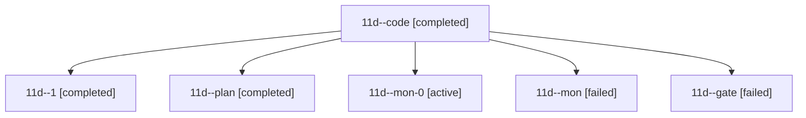

# Session: 11d

[Agent Hoods](../README.md) / [bbugyi200](../users/bbugyi200/README.md) / [athena](../users/bbugyi200/machines/athena/README.md) / [11d](../users/bbugyi200/machines/athena/hoods/11d/README.md) / 11d

Owner: `bbugyi200.athena` · Hood: `11d` · Members: 6

## Lineage

The diagram is an optional enhancement; the ordered table below contains the same lineage in accessible text.

| Role | Agent | State | Model / provider | Timing | Commits | Prompt | Chat |
|---|---|---|---|---|---:|---|---|
| code | 11d--code | completed | gpt-6-luna / codex | 2026-10-18T17:05:00.225807+00:00 → 2026-10-18T17:17:39.965031+00:00 | 0 | — | [Chat](../agents/bbugyi200.athena.11d--code/chat.md) |
| 1 | 11d--1 | completed | gpt-6-luna / codex | 2026-10-18T17:20:39.173276+00:00 → 2026-10-18T17:25:44.749117+00:00 | 0 | [Prompt](../agents/bbugyi200.athena.11d--1/prompt.md) | [Chat](../agents/bbugyi200.athena.11d--1/chat.md) |
| plan | 11d--plan | completed | opus / claude | 2026-10-18T16:22:39.686190+00:00 → 2026-10-18T17:17:39.965031+00:00 | 0 | [Prompt](../agents/bbugyi200.athena.11d--plan/prompt.md) | [Chat](../agents/bbugyi200.athena.11d--plan/chat.md) |
| mon-0 | 11d--mon-0 | active | gpt-6-luna / codex | 2026-10-18T17:25:01.896957+00:00 | 0 | — | — |
| mon | 11d--mon | failed | gpt-6-luna / codex | 2026-10-18T17:16:52.562908+00:00 → 2026-10-18T17:19:50.743591+00:00 | 0 | — | [Chat](../agents/bbugyi200.athena.11d--mon/chat.md) |
| gate | 11d--gate | failed | opus / claude | 2026-10-18T17:04:12.828034+00:00 → 2026-10-18T17:04:39.606654+00:00 | 0 | — | [Chat](../agents/bbugyi200.athena.11d--gate/chat.md) |
